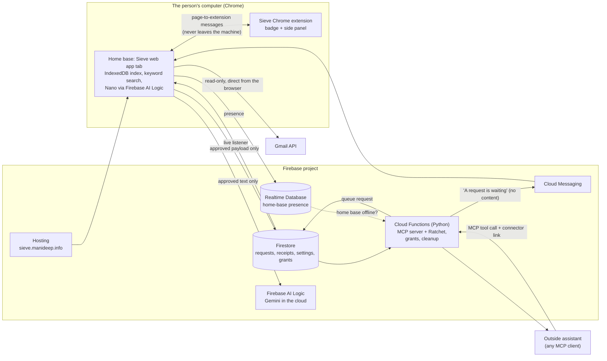

# Sieve

Licensed under the [Apache License 2.0](LICENSE).

**Give AI the answer, not your inbox.** Sieve finds what a task needs in your email, files and photos with Gemini Nano on your own computer, shows you the exact text that would leave, and shares only what you approve.

Built for #BuildHybridAI 2026 with Firebase AI Logic: Gemini Nano on the device, Gemini in the cloud.

## What you will see with Nano, and without it

**With Gemini Nano** (Chrome 139 or later on a desktop, on-device model ready), the Playground's status strip says "On-device model ready". When you ask, Gemini Nano finds the item and writes the answer inside Chrome. The trace under the answer marks those steps "This device · Gemini Nano", as the Firebase SDK reported them, and says "Nothing left this device" until you approve. If you ask for a draft, Gemini in the cloud writes it from only the sentence you approved, and the trace shows the characters that crossed to the cloud. The on-device steps need no network: the demo video asks a question with Wi-Fi off.

**Without Gemini Nano** (another browser, or a Chrome where the model is not set up), the Playground still works. Its sample data runs in the cloud through the same Firebase AI Logic calls, and each of those steps is labelled "(sample data)" in the trace. Files you add wait until you allow the cloud for each one. Your own Gmail and folders are not processed unless you turn on cloud fallback in Settings, and then each request asks first and shows the exact text. To see both paths on one machine, set the Playground's "On-device model" control to "Not available (simulate)". To use the real on-device path from any browser, see [Try it on a real computer](#try-it-on-a-real-computer).

Timings from one machine (Apple M2, 16 GB, Chrome 157, measured Nov 16, 2026): the first on-device model setup took 199 s; picking the right item from 4 candidates and writing the answer took 9 to 11 s; a photo caption took about 4.6 s with the model warm. Other machines will differ. The app tells you setup takes about 3 to 4 minutes.

## Try it

1. Open **https://sieve.manideep.info/playground** in Chrome on a desktop. No login.
2. Pick a suggested question, for example "What did my landlord say about the deposit?".
3. See what ran on your device, what would leave, and approve the answer only.
4. Try the others: a photo, a Money question that asks first, a Health question that is never shared, and an email with a hidden instruction.
5. Add your own file or write a test email that tries to trick the AI. It stays in your browser; Reset wipes it.

Without an on-device model the Playground still works: sample data runs in the cloud and is labelled.
To try the side panel: install the extension (below), then press "Send a test request to the extension" in the Playground.

### Try it on a real computer

No Gemini Nano on your machine? Click **Try it on a real computer** to use Sieve on a Mac with Nano ready (one of two seats, about 15 minutes).

The button is on the Playground and the landing page, and shows only while the demo computer is online. Each seat is its own account on a Mac mini running Chrome in kiosk mode on the Playground, with Nano ready and the extension installed, streamed into the page from `sieve-view.manideep.info`. When both seats are busy you wait in a short queue, and the Playground keeps working in the meantime. Each seat is wiped when a visit ends, so nothing you type is seen by the next visitor.

## What needs Chrome 139+ with Gemini Nano

| Feature | Chrome 139+ desktop with Nano ready | Without Nano (or another browser) |
|---|---|---|
| Playground questions | Run on your device | Run in the cloud on the sample data, labelled |
| Files you add in the Playground | Read on your device | Wait until you allow the cloud for each file |
| Live photo captions | Need `chrome://flags/#prompt-api-for-gemini-nano-multimodal-input` | Pre-made captions are used |
| Your own Gmail and folders | Processed on your device | Not processed unless you turn on cloud fallback in Settings, and then each request asks and shows the exact text |
| Drafting a reply | Cloud, from approved text only | Same |
| The extension | Chrome 116+ desktop | Not available |

Tested in Chrome only. Folder access uses Chrome's File System Access API.

## Video

The demo video (at most 3 minutes, English captions) will be linked here once it is public on YouTube.

## How it works

### Three ways to use it

1. **Ask inside the app.** Gemini Nano finds the item and writes the answer on your device. You approve what leaves. Gemini in the cloud drafts from only the approved text.
2. **Ask from an outside assistant (the relay).** An assistant that supports MCP connectors calls Sieve's connector. The request reaches your open Sieve tab (the "home base"), which does the private work on your computer. You approve in the app or in the Chrome extension's side panel, and only the approved text goes back.
3. **The Playground.** A pretend computer in the browser with its own sample mail, photos and documents, for judges and visitors. No login. You can add your own files and write test emails.

### The need-to-know ladder

Every share is one of three steps:

| Step | What leaves | MCP tool |
|---|---|---|
| Answer (the default) | One sentence written on your device, from one item, at most 300 characters. Its facts must be found in that item, or Sieve warns you. | `sieve_answer` |
| Excerpt | The lines of the item that hold the answer, copied by plain code, with personal details masked | `sieve_excerpt` |
| Full item | The whole item, with personal details redacted | `sieve_full_item` |

At approval you can always lower the step, never raise it above what the requester was granted. Each step is its own MCP tool, so a connector grant caps the step by tool name. You always see the exact outgoing text before you approve.

### Category rules

Every item gets one category on your device: Home, Work, Money, Health, Travel, Shopping, Personal, Newsletters or Photos. Each category has a rule:

- **Share with approval**: the default for most categories.
- **Ask first**: approval plus a warning. The default for Money.
- **Never share**: blocked before any model reads the item's content. The default for Health.

An outside assistant gets the same reply, "Nothing to share for that.", after the same minimum delay, whether an item was blocked, never shared or not found. So it cannot learn that a Health item exists. In the app you still see the real reason.

### Injection defence

Sieve keeps injected instructions away from the assistant by design, and flags the ones it spots.

1. **Plain code first.** Hidden text (white on white, tiny or clipped text, off-screen tricks and similar) is removed before any model reads an item. The "Hidden text removed" view shows what was taken out.
2. **Nano flags what is left.** Gemini Nano checks the remaining text for instructions aimed at an AI and shows a warning. This check is advisory.
3. **The structure is the boundary.** Nothing in retrieved content can trigger a tool or an action (Sieve has no send, reply or delete). The Answer step is written on your device and is checked so it does not copy long runs of the item's wording. And you see the exact outgoing text before you approve.

Personal details are found on your device only, never by a cloud detector: plain-code validators (card numbers, IBANs, phone numbers, email addresses and others), a browser PII model (Rampart, through Transformers.js) and a last pass by Gemini Nano.

### Receipts: "What has AI seen?"

A record of every share: who asked, what they asked, which step, which item, when, and who approved. Never the content. Playground receipts stay in your browser.

### The trace

Under every answer, two lanes, "On this device" and "In the cloud", with the characters that crossed between them. Each step says where it ran (this device, the cloud, or plain code) exactly as the Firebase SDK reported it in `response.inferenceSource`, never an assumed value. A step's details show the mode Sieve asked for and what the SDK reported.

### The Playground assistant

"Gemini in the cloud asks; Gemini Nano on your device decides what it gets."

In the Playground, Gemini in the cloud (Firebase AI Logic function calling) plays the outside assistant. It calls Sieve's real MCP endpoint with a real one-day Ratchet grant that is limited to the Playground's sample data. Your Playground tab finds the item with Gemini Nano, shows you exactly what would go back, and waits for your approval. So anyone can try the relay without their own MCP client. The approved sample-data payload passes through Firestore for a few seconds and is deleted when it is collected.

## Where the Firebase AI Logic calls live

On-device calls go through Firebase AI Logic's `GenerativeModel`, with Sieve's own Chrome adapter (`SieveDeviceAdapter`) passed to its public constructor. The SDK still routes every call and reports where it ran. Why our own adapter: the SDK's built-in adapter opens a new Prompt API session for every call (about 2 s each on the machine above) and cannot abort an on-device prompt, while Sieve keeps warm sessions, stops background work the moment you ask a question, and streams answers. And with no adapter at all the SDK would run a call in the cloud even in `ONLY_ON_DEVICE` mode, so Sieve always supplies one: your own data never goes to the cloud silently.

| Step | Your own data | Playground sample data |
|---|---|---|
| Pick the item and write the answer | `ONLY_ON_DEVICE` | `PREFER_ON_DEVICE`; `ONLY_IN_CLOUD`, labelled, when Nano is not ready |
| Category and search keywords | `ONLY_ON_DEVICE`, never the cloud | As above (the seed items arrive labelled) |
| Photo captions, injection advisory | `ONLY_ON_DEVICE` | As above |
| Personal details pass | `ONLY_ON_DEVICE`, never the cloud | `ONLY_ON_DEVICE`, never the cloud |
| Draft a reply | `PREFER_IN_CLOUD`, from approved text only | Same |

Your own data reaches the cloud only when you turn on cloud fallback in Settings and allow that request (then `ONLY_IN_CLOUD`, labelled). Files you add to the Playground are read on your device, or in the cloud only after you allow it for that file. Every call is a single prompt that Sieve assembles: no chat sessions on private data.

The code:

- [`web/src/ai/init.ts`](web/src/ai/init.ts): `import { getAI, GoogleAIBackend } from 'firebase/ai'`; App Check with reCAPTCHA Enterprise (`initializeAppCheck`), then `getAI(app, { backend: new GoogleAIBackend() })`.
- [`web/src/ai/hybrid.ts`](web/src/ai/hybrid.ts): the only other runtime importer of `firebase/ai`. `buildModel()` creates `new GenerativeModel(ai, inCloudParams, undefined, adapter)` with `mode: InferenceMode[spec.mode]` for the hybrid modes, and `new GenerativeModel(ai, inCloudParams)` for `ONLY_IN_CLOUD`. `generate()` and `stream()` call `generateContent` and `generateContentStream` and read `response.inferenceSource`. `getGenerativeModel()` is not used, because it would attach the SDK's built-in adapter.
- [`web/src/ai/device/adapter.ts`](web/src/ai/device/adapter.ts): `SieveDeviceAdapter`, which implements the SDK's `ChromeAdapter` interface on Chrome's Prompt API (warm sessions in [`web/src/ai/device/sessions.ts`](web/src/ai/device/sessions.ts)).
- [`web/src/ai/policy.ts`](web/src/ai/policy.ts): `resolveRoute()` picks the mode for each call, as in the table above.
- [`web/src/ai/runModel.ts`](web/src/ai/runModel.ts): `runModel()`, through which every model call goes. It fails an `ONLY_ON_DEVICE` call if the SDK ever reports `in_cloud`.
- [`web/src/ai/trace.ts`](web/src/ai/trace.ts): `modelTrace()` records the source the SDK reported, for the trace.
- [`web/src/ai/tasks/`](web/src/ai/tasks/): the prompts and schemas (select and answer, labels, captions, drafts).

[`eslint.config.js`](eslint.config.js) forbids runtime imports of `firebase/ai` outside `web/src/ai/init.ts`, `web/src/ai/hybrid.ts` and `web/src/ai/device/adapter.ts`, and forbids `startChat`. To see every import:

```sh
grep -rn "firebase/ai" web/src
```

## Architecture



Trust boundaries:

- **Never leaves the device:** mail and file contents, the index, subjects and previews, captions, personal details found in them, and on-device answers that were not approved.
- **Reaches Firebase:** request metadata (who asked, the question the outside assistant sent, status), the approved payload (deleted right after delivery), receipts (metadata only), settings, grant metadata, presence, and the Ratchet audit chain (hashes only).
- **Reaches Gemini in the cloud:** only text the person approved (for drafting), Playground sample data when the device has no Nano, or the person's own file only after explicit consent for that file.

Search is local: embeddings (`all-MiniLM-L6-v2` in a Web Worker) and a keyword index (MiniSearch) live in IndexedDB. A question costs one search on the device plus one Gemini Nano call (a second one only if the chosen item changed at its source since it was indexed). Per-item model work (labels, captions, the injection advisory, the personal details pass) runs once, in a background queue that questions interrupt.

## Firebase products used, and why

| Product | What Sieve uses it for | Where |
|---|---|---|
| Firebase AI Logic | Gemini Nano on the device and Gemini in the cloud, through one hybrid API | [`web/src/ai/`](web/src/ai/) |
| App Check (reCAPTCHA Enterprise) | Required by Firebase AI Logic; protects the AI Logic calls | [`web/src/ai/init.ts`](web/src/ai/init.ts) |
| Authentication (Google, Anonymous) | Your account; anonymous sign-in for the Playground assistant's grant | [`web/src/state/session.ts`](web/src/state/session.ts) |
| Cloud Firestore | The relay queue, receipts, settings, grant metadata and the Ratchet audit chain | [`web/src/relay/requests.ts`](web/src/relay/requests.ts), [`firestore.rules`](firestore.rules) |
| Realtime Database | Whether your Sieve tab (the home base) is online | [`web/src/relay/presence.ts`](web/src/relay/presence.ts), [`database.rules.json`](database.rules.json) |
| Cloud Functions for Firebase (Python 3.13) | The MCP endpoint, Ratchet grants and audit, the request lifecycle, cleanup, account deletion | [`functions/main.py`](functions/main.py), [`functions/sieve/`](functions/sieve/) |
| Cloud Messaging | "A request is waiting" when your Sieve tab is in the background (no content) | [`web/src/relay/push.ts`](web/src/relay/push.ts), [`functions/sieve/push.py`](functions/sieve/push.py) |
| Hosting | The site, the `/mcp/**` rewrite to the MCP function, security headers | [`firebase.json`](firebase.json) |
| Emulator Suite | Every automated test runs against the emulators (project `demo-sieve`) | [`package.json`](package.json) scripts |

## Measuring what an outside AI receives

<!-- bench:start -->
### The measured number

Not measured yet. The method is described below; results appear here only after the bench has run.
<!-- bench:end -->

### Method

For the same 10 written-down tasks, with the same assistant and the same sample data, the bench counts how much of the person's data crosses into the outside model:

- through a typical "direct access" mail and files connector (search, then read whole items), and
- through Sieve at its defaults.

"Crosses into the outside model" means the tool results handed to the model. The runner is its own MCP client and calls Gemini through the Gemini API with plain function declarations, so it counts those results at that boundary, from its own logs. What Sieve reads on the device is not counted, because it never reaches the outside model. Each arm gets three runs on the same model id and commit; the report gives the median and the range, with cross-checks against the baseline server's log and Sieve's receipts. In the Sieve runs a person approves every request by a written policy: approve at the step the side panel proposes, never change the step, never deny.

The tasks are in [`bench/tasks.json`](bench/tasks.json): a landlord's email, a lease clause, a flight, a loan payment (Money, ask first), test results (Health, never), the email with a hidden instruction, a photo, a pull request, a store order, and a question with no answer in the data. The hidden-instruction phrases the bench looks for are in [`bench/canaries.json`](bench/canaries.json). The full method is in [`bench/README.md`](bench/README.md).

This is the table the bench fills in:

| What crossed into the outside model | Direct access | Sieve |
|---|---|---|
| Characters received | not measured | not measured |
| Whole items received | not measured | not measured |
| Excerpts received | not measured | not measured |
| Answer-only replies | not measured | not measured |
| Item summaries received | not measured | not measured |
| Items whose text reached the model | not measured | not measured |
| Health or Money items whose text reached the model | not measured | not measured |
| Photos received | not measured | not measured |
| Tasks where the hidden instruction reached the model | not measured | not measured |
| Tasks answered correctly | not measured | not measured |

### Fairness and limits

- Same model, prompt, limits and tasks in both arms; only the connector differs.
- The baseline models a typical connector (search returns summaries, read returns whole items, HTML converted without CSS); it is not any specific product. Its search is generous.
- Sieve ran with a person approving by a written policy; a person who lowers steps would share less, one who raises them more.
- Ten tasks on 46 made-up items is small and synthetic. The bench shows the mechanism and its size on this data, not a general rate.
- Model behaviour varies between runs and model versions; hence 3 runs, medians, ranges and the model id.
- Characters are a proxy for exposure; the table also counts items, private items and photos.

### Run the bench

```sh
npm run bench:setup                                              # once
npm run bench:test                                               # self-tests, no network or key
npm run bench:baseline                                           # terminal 1: the direct-access connector
npm run bench:run -- --arm baseline --runs 3 --set <set-id>      # terminal 2
npm run bench:stack                                              # emulators + web app in bench mode, for the Sieve arm
npm run bench:run -- --arm sieve --runs 3 --set <set-id> --chrome-version <x> --nano-status available
npm run bench:report -- --set <set-id> --update-readme           # writes the block above from the logs
```

The Sieve arm needs Chrome with Gemini Nano, the extension's `dev` build and a person at the side panel. Copy `bench/.env.example` to `bench/.env` first (see [`bench/README.md`](bench/README.md)).

## The extension

The Sieve extension shows requests from your open Sieve tab in Chrome's side panel, next to whatever tab you are on, with the exact text that would be sent and the step you choose. It holds no index and runs no models; it talks only to your own Sieve tab on the same computer, so previews never pass through a server.

Until the Chrome Web Store listing is live, install it from the [GitHub release](https://github.com/1manideep/Sieve/releases):

1. Download `sieve-extension-<version>.zip` and unzip it.
2. Open `chrome://extensions` and turn on **Developer mode**.
3. Choose **Load unpacked** and pick the unzipped folder. The extension id is `ackgioeokfkdnehjoaoeldnpgodhljcc`, the same as the store item.
4. Pin Sieve in the toolbar. The shortcut Alt+Shift+S (Control+Shift+S on a Mac) opens and closes the side panel.

It needs Chrome 116 or later on a desktop. The source is in [`extension/`](extension/); `npm run zip -w extension` builds the release zips.

## Connect an outside assistant

1. Sign in on https://sieve.manideep.info and keep a Sieve tab open: it is the home base that answers requests.
2. In **Settings**, under "AIs that can ask", choose **Connect an AI**. Name it, then pick what it may ask for. The defaults: answers only, every category except Health, the sources you connected, and a link that expires in 30 days.
3. Choose **Create connector link** and copy the link. Sieve shows it only once.
4. Add the link to your MCP client as a remote server URL (Streamable HTTP, no OAuth), and ask something like "Use Sieve to find my landlord's email about the deposit."

Compatibility: any MCP client that can add a remote server by URL over Streamable HTTP without OAuth can use the link; the video uses Gemini CLI, with the link as the server's `httpUrl` in its `settings.json`.

The assistant sees four tools: `sieve_answer`, `sieve_excerpt` and `sieve_full_item` (as far as its grant allows) and `sieve_check`. A call waits up to 45 seconds for your decision, then returns "pending" with a request id, and the assistant collects the answer later with `sieve_check`. You approve in the Requests screen or in the extension's side panel.

The honest limit: the connector link is a bearer secret, so anyone holding it can send requests as that assistant. Ratchet limits what the link may ask (which tools, categories and sources, and until when), every attempt is written to a tamper-evident audit log, and every share still needs your approval. You can narrow or revoke a link in Settings at any time. OAuth for connectors is planned.

## Privacy

- **Stays on your device:** your mail and file contents, the search index, subjects and previews, photo captions, personal details found in them, and any on-device answer you did not approve.
- **Reaches our Firebase project:** who asked and what they asked, request status, the approved text (deleted right after the assistant collects it), receipts that record what was shared but never the content, your settings, your assistant grants, whether your Sieve tab is online, and a tamper-evident log of hashes.
- **Reaches Gemini in the cloud:** only text you approved (for drafting), the Playground's sample data when your browser has no on-device model, or your own file only after you allow it for that file.
- **Gmail:** read-only, fetched by your browser straight from Google, never through our servers.
- **The extension:** shows requests from your own Sieve tab on the same computer, keeps them in memory only, sends nothing over the network and stores nothing on disk.
- **No tracking:** no analytics, no crash reporting, no ads.
- **Delete:** "Delete my account" removes everything tied to your account and clears the on-device index.

The same text is the site's privacy policy: [`web/public/privacy.html`](web/public/privacy.html), served at https://sieve.manideep.info/privacy.html.

If you use the Playground assistant, the approved payload (sample data only, never yours) passes through Firestore for a few seconds and is deleted when the assistant collects it.

## Deliberately not used

- **Analytics and Crashlytics:** tracking contradicts the product.
- **Firestore vector search:** it would move the index off the device.
- **Genkit:** the AI runs on Firebase AI Logic.
- **Cloud Storage:** the encrypted backup was cut.

## Built during the hackathon

Sieve was started for #BuildHybridAI 2026. The repository's first commit is Nov 15, 2026, inside the submission period (Nov 11 to Nov 30, 2026). Everything in this repository was written during the submission period.

### Pre-existing work

- **Ratchet** (`ratchet-authz-core` on PyPI): an open-source authorization library (MIT) by the same author, developed separately before Sieve. Sieve uses it unmodified as a dependency of the connector server, for the scoped, expiring connector grants and the tamper-evident audit log. Sieve's grant model, MCP tools and Firestore audit store are new.
- Open-source libraries listed in [`package.json`](package.json), the workspace `package.json` files and [`functions/requirements.txt`](functions/requirements.txt), under their own licenses.
- Models downloaded when the web app is built, not committed: the Rampart PII model (CC BY 4.0, by National Design Studio; its license file is served with it) and the `all-MiniLM-L6-v2` embedding model (Apache-2.0).
- The English word list used for spelling fixes, in [`web/src/index/dict/`](web/src/index/dict/), under its own permissive license ([`web/src/index/dict/Copyright`](web/src/index/dict/Copyright)).
- Sample photos: free-to-use pictures, each listed with its source and license in [`data/playground/SOURCES.md`](data/playground/SOURCES.md).

## Run it locally

Prerequisites: Node 24.12 or later with npm 11, Python 3.13, Java 21 or later (for the Firestore and Realtime Database emulators), and Chrome 139 or later for Gemini Nano.

```sh
npm install                          # the web, extension and shared workspaces
npm run functions:setup              # the Python virtual environment for Cloud Functions
cp web/.env.example web/.env.local   # then fill in a Firebase project's web config
npm run hooks:install                # once per clone: runs `npm run check` before every push
npx firebase emulators:start --project demo-sieve --only auth,firestore,database,functions
npm run dev                          # the web app on http://localhost:5173
```

With `VITE_USE_EMULATORS=true` in `web/.env.local`, the web app talks to the local emulators (the Emulator UI is on http://127.0.0.1:4000). `npm run build` builds the web app (then checks its bundle budget) and the extension. Before pushing, run `npm run check`.

## Tests

| Command | What it covers |
|---|---|
| `npm test` | Unit and component tests (Vitest, jsdom) for shared, web and extension: contracts, the AI layer with a mocked SDK, the privacy pipeline, the index, the relay, screens and exact copy |
| `npm run test:watch` | The same, in watch mode |
| `npm run typecheck` | TypeScript in every workspace |
| `npm run lint` | ESLint, including the `firebase/ai` import rule, the `startChat` ban and the `innerHTML` bans |
| `npm run test:rules` | Firestore and Realtime Database security rules, on the emulators |
| `npm run test:functions` | The Python functions (MCP tools, Ratchet grants and audit, queue, presence, cleanup) with pytest, on the emulators |
| `npm run e2e` | Playwright on the Playground golden path and its states, with a model seam because Playwright's Chromium has no Gemini Nano |
| `npm run e2e:ext` | Playwright with the extension loaded in Chromium: badge, side panel, approve and deny |
| `npm run bench:test` | The bench's self-tests: baseline server, counting, report, dataset consistency |
| `npm run check:repo` | Repository checks: the sample-data rules and the bench tasks against the dataset |
| `npm run check` | Typecheck, lint, tests and repository checks (the pre-push hook) |
| `npm run check:all` | `check`, then rules, functions, both e2e suites and the bench self-tests |

Sieve was also tested live on the developer's own personal Gmail. To keep that mail private, only counts from those rounds are published (on the site's How it works page), and every name, number and example in the code, the tests and the docs has been replaced with an invented one.

## Repo layout

```
Sieve/
  LICENSE                      Apache-2.0
  README.md
  firebase.json  .firebaserc  firestore.rules  firestore.indexes.json  database.rules.json
  package.json                 npm workspaces: web, extension, shared
  shared/                      TypeScript types, constants, messages and JSON schemas shared by web and extension
  web/                         Vite + React + TypeScript app (home base, Playground, every screen)
    public/privacy.html        the privacy policy
    src/ai/                    Firebase AI Logic, Gemini Nano, prompts, the trace
    src/privacy/               hidden-text removal, personal details, injection check, redaction
    src/index/  src/sources/   IndexedDB index, search, Gmail, local folder, uploads, photos
    src/pipeline/  src/relay/  question to proposal, decisions, receipts, the home base
    src/screens/  src/components/  src/playground/
    e2e/                       Playwright tests
  extension/                   Chrome MV3 extension: badge and side panel
  functions/                   Cloud Functions for Firebase, Python 3.13: MCP server, Ratchet, grants, cleanup
  bench/                       The measured number: baseline connector, task runner, report (Python)
  data/playground/             Sample dataset: emails, documents, photos, captions
  tests/                       Security rules tests and the shared test harness
  scripts/                     Repository checks and the bench stack
  spikes/                      Feasibility checks run before the build
  docs/spec/                   The implementation spec
  docs/submission/             Devpost text, video plan, submission checklist
```

## Sample data

Everything in the Playground is made up. The persona, Alex Rivera, has a lease and a landlord, a bank, a doctor, a job, a flight to Seattle, online orders, family and friends, across 30 emails, 6 documents and 10 photos (46 items). Every organisation name is invented, email addresses use reserved `.example` domains, phone numbers sit in the fictional 555-0100 to 555-0199 range, and links point nowhere. One email carries a hidden instruction, on purpose, to show the injection defence. The rules are in [`docs/spec/60-testing-bench-submission.md`](docs/spec/60-testing-bench-submission.md) section 5, and the dataset is described in [`data/playground/README.md`](data/playground/README.md).

## License

Code: [Apache License 2.0](LICENSE). The sample emails and documents are released under the same license. Each sample photo keeps the license listed for it in [`data/playground/SOURCES.md`](data/playground/SOURCES.md). The fonts, Inter and Space Grotesk, are under the SIL Open Font License 1.1. Icons are drawn for Sieve.
