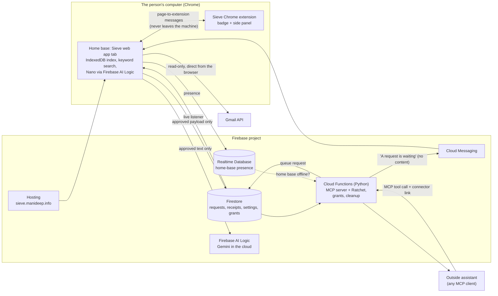

# Sieve implementation spec: 00 Overview

This spec is written so that Sieve can be implemented without design questions. Read this file and [01-contracts.md](01-contracts.md) first; every other spec file builds on them.

- Product design (the "why" and the screens): the design canvas, summarized in section 1 below.
- Source of truth for names, types and data shapes: [01-contracts.md](01-contracts.md). If a component spec seems to disagree with it, the contracts file wins.

| File | Covers |
|---|---|
| 00-overview.md | Product summary, architecture, repo layout, stack, flows, decisions, work packages |
| 01-contracts.md | Shared TypeScript types, Python mirrors, Firestore/RTDB/IndexedDB layout, message formats |
| 10-ai-layer.md | Firebase AI Logic setup, inference modes, availability, every prompt and schema, trace |
| 11-privacy-pipeline.md | Hidden-text removal, PII detection (validators, browser model, Nano), injection check, redaction |
| 20-index-and-sources.md | IndexedDB, keyword index, labelling, Gmail, local folder, uploads, photos, Playground device and seed data |
| 30-relay-server.md | Cloud Functions (Python), MCP server, Ratchet grants and audit, Firestore queue, presence, push, cleanup, rules |
| 40-web-app.md | Every screen, component, state, copy, design tokens, accessibility, errors |
| 50-extension.md | Chrome extension: manifest, side panel, badge, page-to-extension protocol, packaging |
| 60-testing-bench-submission.md | Test plan, emulators, e2e, the measured number (bench), sample dataset rules, video, README, Devpost |
| 70-robustness.md | Failure-mode catalog: every common way things break, with detection, handling, exact messages and tests |
| 80-demo-computer.md | "Try it on a real computer": Mani's Mac mini (M4, 16 GB) streamed into the site so judges without Nano use the real on-device path |

## 1. What Sieve is

**Give AI the answer, not your inbox.** Sieve sits between a person's data (Gmail, a local folder of files and photos) and AI assistants. A model on the person's own device (Gemini Nano in Chrome, through Firebase AI Logic) finds what a request needs and shares the least it can, only with the person's approval.

Three ways to use it:
1. **Ask inside the app (the golden path).** Nano finds the item and writes the answer on the device; the person approves what leaves; Gemini in the cloud drafts from only the approved text.
2. **Ask from an outside assistant (the relay).** An assistant that supports MCP connectors (for example Claude) calls Sieve's connector. The request reaches the person's open Sieve tab (the "home base"), which does the private work; the person approves in the app or in the Chrome extension's side panel; only the approved payload goes back.
3. **The Playground.** A pretend computer in the browser with its own sample mail, photos and documents, for judges and visitors. No login. Visitors can add their own files and write test emails.

Core ideas, all required:
- **The need-to-know ladder.** Three steps of disclosure: `answer` (a sentence written on the device), `excerpt` (the lines that hold the answer), `full` (the whole item, redacted). Default is `answer`. The person can always lower the step at approval, never raise it above what the requester was granted.
- **Category rules.** Every indexed item has one category. Rules per category: `approve` (share with approval), `ask-first` (approval plus a warning), `never` (blocked before any model reads the item content). Defaults: Health `never`, Money `ask-first`, everything else `approve`.
- **Injection defense.** Plain code removes hidden text first; Nano flags suspected instructions (advisory); the real boundary is structural: nothing in retrieved content can trigger a tool or action, step `answer` never forwards outsider wording, and the person sees the exact outgoing text before approving.
- **Receipts ("What has AI seen?").** A record of every share: who asked, what, which step, which item, when, who approved. Never the content.
- **A truthful trace.** Under every answer: each step, where it ran (device, cloud, or plain code) as reported by the SDK, and how many characters left the device.

## 2. Architecture



Trust boundaries:
- **Never leaves the device:** mail and file contents, the index, subjects and previews, captions, PII findings, Nano outputs that were not approved.
- **Reaches Firebase:** request metadata (who asked, the question text the outside AI sent, status), the approved payload (deleted right after delivery), receipts (metadata only), settings, grants metadata, presence, the Ratchet audit chain (hashes only).
- **Reaches cloud Gemini:** only text the person approved (golden path drafting), or Playground sample data when the device has no Nano, or the person's own file only after explicit per-file consent.

## 3. Repo layout

```
Sieve/
  LICENSE                      Apache-2.0
  README.md
  firebase.json  .firebaserc  firestore.rules  firestore.indexes.json  database.rules.json  storage.rules (absent: Storage is not used)
  package.json                 npm workspaces: web, extension, shared
  shared/                      TypeScript types and constants shared by web and extension (see 01-contracts)
    src/types.ts  src/constants.ts  src/messages.ts  src/schemas/*.json
  web/                         Vite + React + TypeScript app (home base, Playground, all screens)
    index.html  vite.config.ts  src/
      main.tsx  app/  screens/  components/  ai/  privacy/  index/  sources/  relay/  playground/  state/  styles/  ml/  robust/
  tests/fixtures/robustness/   robustness corpus (70)
  tests/harness/               FakeGmail, in-memory folder (70)
  extension/                   Chrome MV3 extension (TypeScript, built with Vite)
    manifest.json  src/background.ts  src/sidepanel/  src/shared/
  functions/                   Cloud Functions for Firebase, Python 3.13
    main.py  sieve/  requirements.txt  tests/
  bench/                       The measured number: baseline connector, task runner, report (Python)
  data/playground/             Sample dataset: emails.json, documents/, photos/, captions.json
  docs/spec/                   This spec
  spikes/                      Feasibility checks run before the build
```

## 4. Stack (decisions)

Pin exact versions in `package.json` / `requirements.txt` at implementation time; the majors below are the contract. Each component spec names the libraries it needs.

| Area | Choice |
|---|---|
| Web app | TypeScript 5, React 18.3, Vite 6, React Router 6 (data router), CSS Modules + `styles/tokens.css` (CSS variables) |
| State | Zustand 5 for app state; Dexie 4 for IndexedDB |
| Firebase JS SDK | `firebase` `13.3.0` exactly (hybrid routing in `@firebase/ai` 3.1; default cloud model support; see 10-ai-layer and 01 section 11) |
| AI | Firebase AI Logic, Gemini Developer API backend (free tier) for cloud; Gemini Nano via Chrome for on-device |
| Search | Local vector retrieval: `@huggingface/transformers` 3 running `Xenova/all-MiniLM-L6-v2` (q8) in a Web Worker (WebGPU, WASM fallback), vectors in IndexedDB, brute-force cosine; MiniSearch 7 as a keyword safety net for exact ids and names |
| Files | File System Access API; `pdfjs-dist` for PDF text; `exifr` for photo metadata |
| PII | `libphonenumber-js`, own validators (Luhn, IBAN, SSN, email); browser PII model via `@huggingface/transformers` 3 (candidate: Rampart); Nano last pass |
| Gmail | Google Identity Services token client (`gmail.readonly`), Gmail REST API called from the browser |
| Server | Cloud Functions for Firebase 2nd gen, Python 3.13, `firebase-functions`, `firebase-admin`, `ratchet-authz-core` 0.1.x, Pydantic 2; a hand-written stateless JSON MCP endpoint (the MCP Python SDK only in tests, as the client); replies leave by 55 s because Hosting caps requests at 60 s |
| Extension | Chrome MV3, side panel API, `externally_connectable` |
| Tests | Vitest, React Testing Library, Playwright, Firebase Emulator Suite, pytest |
| Hosting | Firebase Hosting, custom domain `sieve.manideep.info` |

Not used, on purpose (say so in the README): Analytics, Crashlytics (tracking contradicts the product), Firestore vector search (would move the index off the device), Genkit (the AI runs on Firebase AI Logic), Cloud Storage (the encrypted backup was cut).

## 5. Key flows

### 5.1 Golden path: Ask inside the app

```mermaid
sequenceDiagram
  actor P as Person
  participant UI as Ask screen
  participant IX as Index (IndexedDB + MiniSearch)
  participant PR as Privacy pipeline
  participant N as Nano (ONLY_ON_DEVICE)
  participant G as Gemini cloud (PREFER_IN_CLOUD)
  participant R as Receipts
  P->>UI: question
  UI->>IX: keyword search, top 5 (+ live Gmail search)
  IX-->>UI: candidates (rule "never" filtered out, noted in trace)
  UI->>N: pick the item that answers + write the answer (single prompt, structured output)
  N-->>UI: chosen item, answer, excerpt span
  UI->>PR: clean + redact excerpt/full; injection check
  UI-->>P: ladder (answer / excerpt / full) with exact outgoing text, warnings, trace
  P->>UI: approve step (or deny)
  UI->>G: draft from the approved text only (if the person asked for a draft)
  UI->>R: receipt (metadata only)
```

### 5.2 Relay: an outside assistant asks

```mermaid
sequenceDiagram
  participant A as Outside assistant
  participant F as MCP function (+ Ratchet)
  participant Q as Firestore request doc
  participant H as Home base tab
  participant E as Extension side panel
  A->>F: tools/call sieve_answer {question} via connector link
  F->>F: look up grant by link, Ratchet authorize (tool, category scope, expiry)
  F->>F: presence check (RTDB); offline -> return "home base offline"
  F->>Q: create request (status queued), send FCM "A request is waiting"
  H->>Q: claim (status claimed), search + Nano + privacy pipeline locally
  H->>E: preview (local message), badge 1
  E->>H: decision (approve step / deny)
  H->>Q: response (approved payload only), status answered
  F-->>A: payload within the wait window, else "pending" + request id
  A->>F: sieve_check {request_id} (later)
  F->>Q: read, delete payload, receipt
```

Wait window: the tool call waits for an answer up to `RELAY_WAIT_SECONDS` (contract constant, default 45). If not answered by then it returns a pending result with the `requestId` and the instruction to call `sieve_check` after the person approves. This keeps Sieve working whatever the client's own tool timeout is.

## 6. Decisions already made (do not reopen during implementation)

1. Every share is approved by the person in the hackathon build; no auto-approve. Amended Nov 20 by the owner, overriding the Nov 15 review for testing: each connection can be put on "Auto-approve answers" for 2 hours, on that computer only, for clean answer-step proposals only, with a receipt for every answer (40 section 13.8.9). Off by default; everything else still waits for the person.
2. Real data never silently goes to the cloud. On a device without Nano, the person's own data is not processed unless they turn on cloud fallback in Settings, and even then each request asks and shows the exact text. Playground sample data falls back to the cloud automatically and is labelled.
3. No multi-turn chat sessions on private data; every Nano call is a single prompt assembled by Sieve.
4. Ladder steps are separate MCP tools, so a Ratchet grant can cap the step by tool name.
5. One Ratchet grant per outside assistant, tied to its own connector link (bearer secret). Revocable and narrowable from Settings. OAuth for connectors is later.
6. The extension is a thin approval panel: no index, no model calls; it talks to the home base tab only through local page-to-extension messaging.
7. Categories are a fixed set (01-contracts `CATEGORIES`), one per item; no tree walking at question time.
12. Retrieval is local and vector-first (measured: top-5 recall 22/22 vs 18/22 for keyword on paraphrased questions). Embeddings never leave the device. Question time is retrieval (milliseconds) plus exactly one Nano call (one more only when the chosen item turns out deleted or changed at its source); all per-item model work happens once, in a background ingest queue that questions preempt.
8. PII is found on the device only; never by a cloud detector.
9. The trace shows the inference source the SDK reports, never an assumed one.
10. Playground data lives in its own IndexedDB database and never reaches Firestore; Playground receipts are local only (exception only if the optional Playground outside assistant is built: its sample-data payload passes through Firestore for a few seconds).
11. The phone approval with end-to-end encryption is out of scope for the hackathon build.

## 7. Work packages for implementation

Each work package is one focused build session (or a few), built on `dev`. Merge to `main` only when the whole build is finished and verified. Order matters where a package depends on another.

| WP | Builds | Spec | Depends on | Done when |
|---|---|---|---|---|
| WP1 | Monorepo scaffold, `shared/` types and constants, design tokens, app shell and routing, Firebase init with emulators | 00, 01, 40 (shell) | none | `npm run dev` shows the shell; emulators start; types compile |
| WP2 | AI layer (`web/src/ai/`) | 10 | WP1 | unit tests pass with a mocked SDK; spike page reports availability and a real Nano answer |
| WP3 | Privacy pipeline (`web/src/privacy/`) | 11 | WP1 | test corpus passes the thresholds in 11 |
| WP4 | Index and sources, Playground seed data | 20 | WP1, WP2 (labelling), WP3 (sanitize on ingest) | Playground loads 30 emails, 10 photos, 6 documents; search returns the landlord thread first |
| WP5 | Screens: Ask (golden path) and Playground first, then Requests, Sources, Seen, Settings | 40 | WP2, WP3, WP4 | golden path works end to end in the Playground, with and without Nano (simulated) |
| WP6 | Functions: MCP server, Ratchet grants and audit, queue, presence, FCM, cleanup, rules | 30 | WP1 | emulator integration tests pass; a real MCP client completes a relay round trip |
| WP7 | Extension | 50 | WP5 (Requests), WP6 | badge and side panel approve a relay request on a real Chrome |
| WP8 | Bench, e2e tests, dataset checks | 60 | WP5, WP6 | the measured number is produced from logs |
| WP9 | Deploy, custom domain, App Check production, README, Devpost text, video assets | 60 | all | submission checklist in 60 is all ticked |
| WP10 | Demo computer: seats on the Mac mini, seat broker, web viewer, Cloudflare Tunnel, `/try` page | 80 | WP5, WP7, WP9 | section 10 acceptance tests in 80 pass; a judge visit from another network works |

Build order (from the design): WP1 → WP2 + WP3 + WP6 in parallel → WP4 → WP5 (golden path + Playground) → checkpoint (golden path solid?) → WP7 → WP8 → WP9. If the golden path is not solid at the checkpoint, the relay polish and extension wait.

## 8. Things the person (Mani) must do, not the code

- Create the Firebase project and put it on the Blaze plan (Cloud Functions require it); set a budget alert.
- Enable Firebase AI Logic (Gemini Developer API), App Check with reCAPTCHA Enterprise, Authentication (Google and Anonymous providers), Firestore, Realtime Database, Cloud Messaging.
- Create the Google Cloud OAuth client and consent screen for `gmail.readonly` in testing mode; add his own account as a test user.
- Point `sieve.manideep.info` at Firebase Hosting.
- Create the Chrome Web Store developer account and submit the extension by Nov 24.
- Turn on `chrome://flags/#prompt-api-for-gemini-nano-multimodal-input` on the demo machine.

## 9. Conventions

- TypeScript strict mode. No `any` in shared types. Named exports.
- Firestore field names are camelCase; Python models use Pydantic aliases to match.
- All times: Firestore `Timestamp` in Firestore, epoch milliseconds in IndexedDB and messages.
- User-facing copy is plain English, short sentences, no em dashes. Copy given in 40-web-app.md is final unless it does not fit.
- Every module that calls a model goes through `web/src/ai/` so the trace is always recorded.

## 10. Decisions after the design review (Nov 16)

An adversarial review of the whole design, written as a strict judge would score it, produced these decisions. They **override the component specs where they differ**.

| # | Decision | Overrides / touches |
|---|---|---|
| D1 | **The Playground outside assistant is core, not optional.** Cloud Gemini (Firebase AI Logic function calling) plays the outside AI and calls the real MCP endpoint with a real Ratchet grant; Nano on the device decides what it gets. One-line story: "Gemini in the cloud asks; Gemini Nano on your device decides what it gets." This makes the hybrid undeniable and the relay testable by judges. Decision 10 is amended accordingly (a sample-data payload passes through Firestore for a few seconds). | 30 section 16, 40 Playground, decision 10 |
| D2 | **No third-party assistant on screen.** The relay segment of the video uses Gemini CLI (Google's open-source agent; verify on day 1 that it connects to the connector over HTTP) or the Playground assistant. Claude and others appear only as one line of compatibility text in the README. | design sections 14 and 21, 30 sections 5 and 17, 60 section 6.3 |
| D3 | **Proof for judges without Nano.** Video: an offline shot (Wi-Fi off, ask, on-device answer; trace shows on_device and "0 characters left this device"). Playground: when Nano is not ready, a 20-second recorded clip of the same question on a Nano machine next to the live cloud answer. README opens with "What you will see with Nano, and without it". Setup copy says "about 3 to 4 minutes" (measured). Verify on day 1 that on-device works offline through the SDK and App Check. | 40 sections 13.2a and 13.9, 60 sections 6.3 and 7 |
| D4 | **Two-lane trace** (device lane, cloud lane, with the characters that crossed on the arrow between them); the golden-path suggested questions include a draft step so the cloud always appears. | 40 trace component, 10 section 12.10 |
| D5 | **The answer step is capped**: one item, at most 300 characters, facts must be found in that item (else the `unverified-answer` warning). | 10, 11 buildStepOption |
| D6 | **Outside assistants cannot tell "blocked" from "no match".** Blocked, never-shared and no-match all return "Nothing to share for that." after the same minimum delay, so an assistant cannot learn that a Health item exists. In the app, the person still sees the real reason. | 30 tool results, 10 pipeline outcomes |
| D7 | **Off-script questions**: measure the typo and date fixes on the spike set before WP4 is done (the console run showed 10/10 typo recovery; the saved file predates it); show "Searching for: …" when a question was corrected; aggregate questions ("summarize my week", "how many emails from my bank") get a helpful reply ("Sieve answers from one item at a time, so it shares as little as possible. Try asking about one email."); three messy questions join the e2e suite. | 20 parseQuestion, 40, 60 |
| D8 | **Judging-window reliability (decided: Mani turns on the paid tier when it is needed; reminder set for Nov 26):** Gemini Developer API on the paid tier from Nov 27 to Dec 16 with a budget alert; a per-uid daily cap on cloud calls for anonymous Playground users; a size cap on cloud consent for uploaded files; test the hosted Playground in Incognito, Guest and a fresh profile on a machine without Nano; a daily smoke check Dec 10 to 16. | 10 sections 8 and 9.6, 40 section 13.9, 60 |
| D9 | **"Use your own data" is fenced for judges**: before Google sign-in, explain that Gmail access is in testing mode and offer the local folder instead, so nobody hits Google's "access blocked" page. | 40 Sources and Setup |
| D10 | **Photos are free-to-use pictures Mani picks** (funny ones, for the demo's impact). Each image's source and licence go in `data/playground/SOURCES.md`; only licences that allow reuse in a public repo; no logos or trademarks; avoid identifiable people unless the licence covers it (the rules forbid personal data in the repo). | 20 Playground photos, design section 11 |
| D11 | **Security headers ship in WP1** (CSP, frame-ancestors, referrer policy), not later. | 40, firebase.json hosting headers |
| D12 | **Say plainly how on-device works**: the README states that on-device calls go through Firebase AI Logic's `GenerativeModel` with Sieve's Chrome adapter, why (warm sessions, abort, never silently cloud), and where in the code; re-run the Nano spikes through `firebase/ai` on day 1. | 10, 60 README |
| D13 | **Full scope (decided by Mani): build everything in this spec; there is no cut order and no golden-path-only phase.** Nov 17 to 18: design freeze plus the day-1 checks (Nano through `firebase/ai` with both adapters, on-device with Wi-Fi off, Gemini CLI against a stub connector, the hosted App Check in Incognito, cloud quotas). Nov 19 onward: all work packages in the section 7 build order, in parallel where their dependencies allow. Nov 28: video, README, Devpost text. Nov 29: submit; production frozen until judging ends Dec 16. | 00 section 7, design section 18, 70 section 16 |
