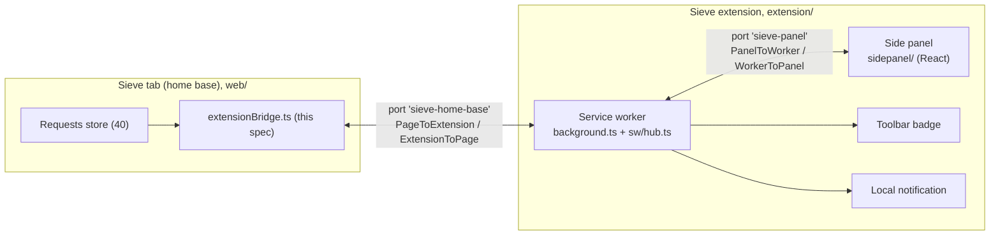
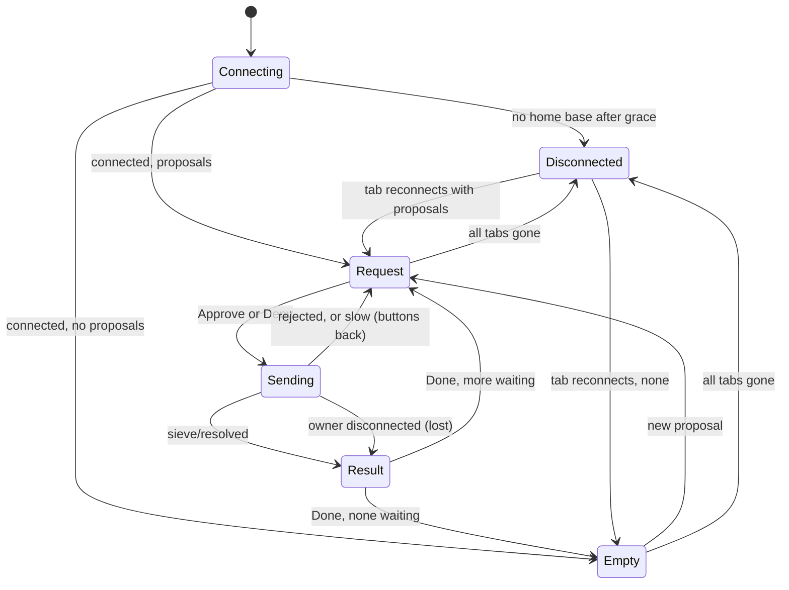

# Sieve implementation spec: 50 Extension

Read [00-overview.md](00-overview.md) and [01-contracts.md](01-contracts.md) first. This file specifies everything in `extension/`, plus the page end of the page-to-extension protocol (`web/src/relay/extensionBridge.ts` and its helpers), because the two ends must be built and tested together. Types and constants come from `shared/` exactly as 01 defines them. Where this file needs something 01 does not have, it is listed in section 18 (Contract change requests) and this file says what to do until it is accepted.

Work package: WP7 (00 section 7). Depends on WP5 (Requests screen and the proposal pipeline) and WP6 (relay functions). The extension itself can be built and fully tested against a stub page before WP5 and WP6 are done.

## 1. What the extension is, and is not

The extension is a thin approval panel (00 decision 6). It lets the person approve or deny an outside assistant's request from Chrome's side panel, next to whatever tab they are on, without switching to the Sieve tab.

It does:
- Accept a long-lived port from the Sieve web app tab (the home base) and from other Sieve app tabs, on this computer only.
- Keep the latest list of `ProposalPreview` objects in memory.
- Show a badge count on the toolbar icon when a new request waits, and open its toolbar popup by itself while Chrome has focus (setting "Open when a request arrives", default on); when the popup cannot open, show a local notification instead (section 7.7).
- Show the request, the ladder with the exact outgoing text for each step, warnings, and Approve / Deny in the side panel.
- Send the person's `Decision` back to the tab that owns the request, with `decidedBy: 'extension'`.
- Focus or open the Sieve tab ("Open Sieve").

It does not:
- Hold an index, read mail or files, or call any model (Nano or cloud).
- Make any network request. It has no host permissions and its CSP blocks `connect-src`.
- Talk to Firebase. Previews never pass through a server (design section 3).
- Inject content scripts or read the pages the person visits.
- Write any preview to disk.

Platform: Chrome desktop 116 or later (needed for `chrome.sidePanel.open()`). The extension does not need Gemini Nano; only the home base does.



## 2. Platform facts this design relies on (checked Nov 16, 2026)

Every API below was read on the official Chrome or Playwright documentation on Nov 16, 2026. Anything not confirmed there is in section 17.

| Fact | Consequence for Sieve |
|---|---|
| Side Panel API needs the `"sidePanel"` permission and `"side_panel": { "default_path" }`. `sidePanel.open()` is Chrome 116+ and "may only be called in response to a user action". | `minimum_chrome_version` is 116. Opening the panel from code only happens from a click (action icon or notification), never on a timer or message. |
| `sidePanel.setPanelBehavior({ openPanelOnActionClick })` toggles the panel when the toolbar icon is clicked. Default is `false`. | The service worker sets it to `true` on every start. Clicking the icon is the main way to open the panel. |
| A global side panel (no `tabId` in `setOptions`) "remains open when navigating between tabs". | Sieve uses one global panel, so it stays open while the person moves between the assistant's tab and others. |
| `externally_connectable.matches` lists the web pages that may connect. If omitted, no pages can connect. If present without `"ids"`, other extensions lose the ability to connect. | Only the Sieve origins can connect; no other extension can. |
| Match patterns match all ports unless an explicit port is given. | `http://localhost:5173/*` matches port 5173 only. |
| `MessageSender.origin` (Chrome 80+), `url`, `tab`, `frameId`. `Port.sender` is present on ports passed to `onConnectExternal`. | The worker checks `origin`, `frameId === 0` and `tab` on every external port. |
| An extension cannot send a message to a web page that did not open a channel. Messages are JSON-serialized, max 64 MiB. | The page always opens the port. All payloads are plain JSON. |
| Service worker: stopped after 30 s of inactivity; events and extension API calls reset the timer (Chrome 110). Since Chrome 114, "sending a message with long-lived messaging keeps the service worker alive" and "opening a port no longer resets the timers". Globals are lost when the worker stops. | The page sends a keepalive message every 20 s while connected (section 6.5). The worker can be stopped at any time; the page reconnects and re-sends the full list, so the worker never needs to persist previews. |
| `chrome.storage.session` is in memory only, "will not be persisted to disk", cleared on browser restart and on extension reload, update or disable, 10 MB, not exposed to content scripts by default; needs the `"storage"` permission. | Used only for the list of request ids already announced, so a worker restart neither repeats a notification nor opens the popup again. No content is stored. |
| `chrome.storage.local` persists across restarts and needs the same `"storage"` permission. (Added Nov 20.) | Used only for the `settings` key: booleans the person sets in the popup (section 7.10). Never request content, names or ids. |
| `chrome.action.openPopup()` is available to every extension from Chrome 127 and opens the popup in the given window. The e2e suite shows it works from the service worker without a user gesture, for the window that has focus. (Added Nov 20.) | A new request opens the popup by itself (section 7.7), only in the last focused normal window while it has focus. `sidePanel.open()` still needs a gesture, so it is never the fallback on arrival. |
| `chrome.action.setBadgeText` (empty string clears; about 4 characters fit), `setBadgeBackgroundColor`, `setBadgeTextColor` (Chrome 110+), `setTitle`. No permission needed. `onClicked` does not fire if the action has a popup. | No popup. Badge shows the waiting count; the title explains it. |
| `chrome.notifications` needs the `"notifications"` permission; `create()` with `type: 'basic'` needs `iconUrl`, `title`, `message`; `iconUrl` may be a packaged resource; `onClicked`, `clear()`. On macOS `imageUrl` and button icons are not shown. | One basic notification per new request, packaged icon, no buttons, no image. |
| MV3 CSP for extension pages cannot be relaxed below `script-src 'self' 'wasm-unsafe-eval'; object-src 'self';`. All code must be bundled; remote code is rejected by the Web Store. | Strict CSP (section 4), everything bundled, fonts included as files. |
| The manifest `"key"` keeps the extension ID stable when loaded unpacked. The key comes from the Developer Dashboard: Package tab, "View public key", pasted as one line. | The unpacked build and the Web Store item share one ID, so the web app needs one `EXTENSION_ID` (section 5). |
| Web Store: single purpose, a justification per permission, a remote code declaration, data-use disclosure "even when data is processed or stored locally", and a privacy policy for items that handle user data. Review "within a few days, but it can take up to a few weeks"; after approval there are up to 30 days to publish. Listing needs a 128x128 icon and at least one 1280x800 screenshot. | Listing text and disclosures in section 13. Submit by Nov 24 (design section 18). |
| Playwright: extensions only work in Chromium launched with a persistent context; `channel: 'chromium'` allows headless; Google Chrome and Microsoft Edge removed the side-loading flags; the extension id is read from the service worker URL. | E2E uses Playwright's bundled Chromium with `--load-extension` (section 14.2). |

## 3. Folder layout

```
extension/
  package.json
  tsconfig.json
  vite.config.ts
  manifest.json              source manifest (the dev variant, in full; section 4)
  scripts/
    build.mjs                vite build + manifest transform per mode (dev | release | store)
    zip.mjs                  zips dist/ and dist-store/ into ../artifacts/
    ext-id.mjs               prints the extension id derived from manifest.json "key"
    lint-dist.mjs            fails if built JS contains remote code or network APIs
    make-icons.mjs           renders icons/sieve.svg to PNGs with Playwright (run once, PNGs committed)
  icons/sieve.svg            icon source (teal shield with a check, from the mockups)
  public/icons/icon-16.png  icon-32.png  icon-48.png  icon-128.png
  src/
    background.ts            service worker entry: calls register(chrome) at top level
    sw/register.ts           wires chrome events to the hub; the only file that touches chrome.* in the worker
    sw/hub.ts                pure state: connections, union, ownership, decisions, resolved, view
    sw/badge.ts              badge text, colour and title from the hub
    sw/notify.ts             notification create/clear and the announced-id set
    sw/focus.ts              open or focus the Sieve tab
    shared/validate.ts       validation of PageToExtension messages (hand-written guards)
    shared/internal.ts       panel <-> worker message types and PanelState
    shared/env.ts            build-time constants (APP_URL, ALLOWED_ORIGINS, BUILD_MODE)
    shared/labels.ts         step labels, date format, copy helpers
    sidepanel/index.html
    sidepanel/main.tsx       mounts <App/>, imports fonts and panel.css
    sidepanel/App.tsx
    sidepanel/usePanelPort.ts
    sidepanel/components/    Header, StatusTag, RequestCard, ItemSummary, StepPicker, OutgoingText,
                             WarningList, DecisionButtons, ResultCard, AlsoWaiting, EmptyState,
                             DisconnectedState, ConnectingState, Footer
    sidepanel/*.module.css
    sidepanel/panel.css      imports web tokens, defines panel aliases (section 8.2)
  test/                      Vitest unit and component tests (section 14.1)
    fakeChrome.ts  fixtures.ts  *.test.ts  *.test.tsx
  e2e/                       Playwright (section 14.2)
    playwright.config.ts  fixtures.ts  serve-stub.mjs  stub/index.html  stub/stub.js  *.spec.ts
```

Build outputs (all git-ignored): `extension/dist-dev/`, `extension/dist/` (release), `extension/dist-store/`, and `artifacts/` at the repo root for zips. Add `extension/dist*/` and `artifacts/` to `.gitignore` if WP1 did not.

Built package layout (same for every mode):

```
manifest.json
background.js
sidepanel/index.html
assets/*.js  assets/*.css  assets/*.woff2
icons/icon-16.png  icon-32.png  icon-48.png  icon-128.png
```

## 4. Manifest

### 4.1 Source manifest (`extension/manifest.json`, dev variant, in full)

```json
{
  "manifest_version": 3,
  "name": "Sieve",
  "version": "0.1.0",
  "description": "Approve what your AI assistant may see. Requests from your open Sieve tab appear in a side panel with the exact text to be sent.",
  "homepage_url": "https://sieve.manideep.info",
  "minimum_chrome_version": "116",
  "icons": {
    "16": "icons/icon-16.png",
    "32": "icons/icon-32.png",
    "48": "icons/icon-48.png",
    "128": "icons/icon-128.png"
  },
  "action": {
    "default_title": "Sieve",
    "default_icon": {
      "16": "icons/icon-16.png",
      "32": "icons/icon-32.png"
    }
  },
  "background": {
    "service_worker": "background.js",
    "type": "module"
  },
  "side_panel": {
    "default_path": "sidepanel/index.html"
  },
  "permissions": ["sidePanel", "notifications", "storage"],
  "externally_connectable": {
    "matches": ["https://sieve.manideep.info/*", "https://sieve-manideep.web.app/*", "http://localhost:5173/*"]
  },
  "content_security_policy": {
    "extension_pages": "script-src 'self'; object-src 'none'; base-uri 'none'; form-action 'none'; frame-src 'none'; connect-src 'none'; img-src 'self'; font-src 'self'; style-src 'self'"
  },
  "key": "REPLACE_WITH_ONE_LINE_PUBLIC_KEY_FROM_THE_DEVELOPER_DASHBOARD"
}
```

Notes:
- `description` is 128 characters (the Web Store summary limit is 132; a unit test enforces it).
- Not present on purpose: `host_permissions`, `content_scripts`, `web_accessible_resources`, `optional_permissions`, `commands`, `default_popup`, `tabs`, `scripting`, `activeTab`. Each would widen access or review scope without a feature that needs it.
- `externally_connectable` has no `"ids"`, so no other extension can connect.
- The `version` here is overwritten at build time from `extension/package.json` so the two never drift.
- The `key` value is filled in step 1 of the work plan (section 15). Until then, use the local key described in section 5.2.

### 4.2 Variants produced by `scripts/build.mjs`

| Mode | Output | `externally_connectable.matches` | `key` | Used for |
|---|---|---|---|---|
| `dev` | `extension/dist-dev/` | all three entries | kept | Local development against `npm run dev` (Vite on 5173), Playwright e2e, the bench and video stack (60) |
| `release` | `extension/dist/` | `["https://sieve.manideep.info/*", "https://sieve-manideep.web.app/*"]` only | kept | The zip judges load unpacked; same ID as the store item |
| `store` | `extension/dist-store/` | `["https://sieve.manideep.info/*", "https://sieve-manideep.web.app/*"]` only | removed | Upload to the Chrome Web Store (the store signs with its own key, which is the same key) |

Why localhost is dropped outside dev: any local program serving `http://localhost:5173` could otherwise connect and show the person fake requests. The released extension should only ever trust the hosted app. `https://sieve-manideep.web.app` is Hosting's default domain for the same app, kept until the custom domain is live (added Nov 18; `extension/scripts/modes.mjs`).

### 4.3 Build-time constants (`src/shared/env.ts`)

```ts
declare const __BUILD_MODE__: 'dev' | 'release' | 'store';
declare const __APP_URL__: string;
declare const __ALLOWED_ORIGINS__: readonly string[];

export const BUILD_MODE = __BUILD_MODE__;
export const APP_URL = __APP_URL__;                 // 'http://localhost:5173' in dev, else 'https://sieve.manideep.info'
export const ALLOWED_ORIGINS = __ALLOWED_ORIGINS__; // must equal the origins of the manifest matches for that mode
export const REQUESTS_PATH = '/requests';           // Requests screen route (40). Change here if 40 names it differently.
export const HOME_PATH = '/ask';                    // the signed-in home, Ask (40, route map of Nov 20); '/' is the public landing
```

`vite.config.ts` sets these with `define`, from the mode passed by `build.mjs`. A unit test checks that `ALLOWED_ORIGINS` for each mode equals the origins derived from that mode's manifest `matches`.

## 5. Extension ID

### 5.1 One ID everywhere

The web page must know the extension ID to call `chrome.runtime.connect(EXTENSION_ID, { name: HOME_BASE_PORT_NAME })`. Because the dev and release builds carry the store item's public key, the unpacked extension, the judges' zip and the Web Store item all have the same ID. The web app therefore needs one constant.

- Preferred: `EXTENSION_ID` exported from `shared/src/constants.ts` (contract change request CR-1, section 18).
- Until CR-1 is accepted: define `export const EXTENSION_ID = '<32 letters a-p>';` in `web/src/relay/extensionId.ts` and import it from there. When CR-1 lands, delete that file and import from `@sieve/shared`.

### 5.2 Getting the key

Do this first in WP7:
1. Mani creates the Web Store item: Developer Dashboard, "Add new item", upload any valid zip of the extension (`npm run build:store -w extension && npm run zip -w extension`), and do not submit.
2. Package tab, "View public key". Copy the text between the BEGIN and END lines, remove line breaks, paste as the `"key"` value in `extension/manifest.json`.
3. Run `npm run id -w extension`; it prints the ID. Put it in `EXTENSION_ID`.
4. Load `extension/dist-dev/` unpacked and confirm `chrome://extensions` shows the same ID as the dashboard's Item ID.

If the dashboard is not available yet, generate a temporary local key so development is not blocked, and switch to the dashboard key as soon as it exists (the ID changes once):

```sh
openssl genrsa 2048 | openssl pkcs8 -topk8 -nocrypt -out extension/.dev-key.pem
openssl rsa -in extension/.dev-key.pem -pubout -outform DER | openssl base64 -A
```

The second command prints the one-line value for `"key"`. `extension/.dev-key.pem` is git-ignored and never needed after the switch. The public key itself is not a secret and is committed.

### 5.3 `scripts/ext-id.mjs`

Derives the ID the way Chrome does: base64-decode `key` (DER SubjectPublicKeyInfo), SHA-256 it, take the first 16 bytes as 32 hex digits, map each hex digit `0-9a-f` to the letters `a-p`. Prints the ID; with `--check <id>` exits non-zero if it differs. A unit test asserts `EXTENSION_ID === deriveId(manifest.key)`.

```ts
export function deriveExtensionId(base64Key: string): string;   // in scripts/ext-id.mjs, also imported by the test
```

## 6. The page-to-extension protocol

The message types are fixed by 01 section 6 (`PageToExtension`, `ExtensionToPage`, `ProposalPreview`, `Decision`). This section fixes the behaviour around them.

### 6.1 Sequence

```mermaid
sequenceDiagram
  participant P as Sieve tab (extensionBridge)
  participant W as Extension service worker
  participant S as Side panel
  P->>W: runtime.connect(EXTENSION_ID, {name: 'sieve-home-base'})
  W->>W: check name, origin, frameId, tab; start 5 s hello timer
  P->>W: sieve/hello {homeBase, appVersion}
  W-->>P: sieve/hello-ack {extensionVersion}
  P->>W: sieve/pending {proposals: [...]} (full list)
  W->>W: union, badge, notify new ids
  W-->>S: panel/state
  loop every 20 s while connected
    P->>W: sieve/pending (same full list, keepalive)
  end
  S->>W: panel/decide {requestId, approved, step}
  W->>W: validate against the owner's preview
  W-->>P: sieve/decision {decision, decidedBy 'extension'}
  P->>P: validate, finalizeDecision, write to Firestore
  P->>W: sieve/resolved {requestId, outcome}
  P->>W: sieve/pending (list without it)
  W-->>S: panel/state (result card)
  Note over P,W: If the worker stops, the port disconnects.<br/>The page reconnects at once and repeats hello + pending.
```

### 6.2 Rules for the page (owned here, implemented in `web/src/relay/extensionBridge.ts`)

1. Connect only if `globalThis.chrome?.runtime?.connect` is a function. Chrome exposes `chrome.runtime` to a page only when some installed extension lists the page in `externally_connectable`; otherwise the bridge status is `unsupported` and nothing else happens.
2. Open exactly one port per tab, named `HOME_BASE_PORT_NAME`. Send `sieve/hello` immediately, with `homeBase: true` only when this tab is the registered home base (30 and 40 decide that), and `appVersion` = the web app's version string.
3. After `sieve/hello-ack`, send `sieve/pending` with the full current list, then again every time the list changes, and every 20 s as a keepalive (section 6.5).
4. The list contains only proposals for outside requests (`requester.kind === 'outside'`) whose request is waiting for the person (Firestore status `awaiting-person`), sorted by `Proposal.createdAt`, oldest first. In-app Ask proposals are never sent (the person is already in the app). At most 20 entries; if more wait, send the oldest 20.
5. Each entry is `toPreview(proposal)` (section 6.4). Never send `related`, `trace`, record ids or `from`.
6. When a request leaves the waiting state, send `sieve/resolved` with:
   - `approved`: the approved payload was written to the request doc.
   - `declined`: the decline was written.
   - `expired`: the request expired or was revoked before a decision.
   - `error`: nothing could be written (so nothing was shared).
   Then send the new `sieve/pending` list without it. Send `resolved` whether the decision came from the extension or the app.
7. On `sieve/decision`: accept it only if all hold: a proposal with that `requestId` is in the current list; `decision.decidedBy === 'extension'`; if `approved`, `step` is set, the option whose `step` equals it has `available: true`, `step` is not above `maxStep` (by `LADDER_STEPS` index) and `outcome === 'ready'`. Then replace `itemIds` with `[proposal.item.recordId]` (the extension never knows record ids; contract change request CR-2) and call `finalizeDecision(proposal, decision)`. If any check fails, ignore the message and re-send `sieve/pending`.
8. On `sieve/open-app`: navigate to the Requests screen, selecting `requestId` if given. The worker focuses the tab itself (section 7.9).
9. On port disconnect: if the status was `connected`, reconnect at once (attempt 1 has no delay), then back off.

### 6.3 Rules for the extension

1. Accept external ports only through `chrome.runtime.onConnectExternal` in the service worker. The side panel never listens to external events.
2. Reject (call `port.disconnect()` and keep no state) when any of these fail: `port.name === HOME_BASE_PORT_NAME`; `port.sender.origin` is in `ALLOWED_ORIGINS`; `port.sender.frameId === 0` (top frame only, so a Sieve page framed inside another site cannot connect); `port.sender.tab` is present; fewer than 8 connections are open.
3. The first message must be a valid `sieve/hello` within 5 s, or the port is disconnected.
4. Validate every message (section 6.6). Ignore invalid ones. After 5 invalid messages on one port, disconnect it.
5. Never act on content: previews are displayed as text, decisions go back only to the port that sent the preview, and no message can make the extension open a URL other than `APP_URL` or the sender's own tab.

### 6.4 `toPreview` (`web/src/relay/toPreview.ts`)

```ts
import type { Proposal, ProposalPreview } from '@sieve/shared';

export function toPreview(p: Proposal): ProposalPreview {
  return {
    requestId: p.requestId,
    requester: p.requester,
    question: p.question,
    requestedStep: p.requestedStep,
    maxStep: p.maxStep,
    ...(p.item ? { item: { title: p.item.title, kind: p.item.kind, category: p.item.category, date: p.item.date } } : {}),
    options: p.options.map(o => ({
      step: o.step, text: o.text, chars: o.chars, redactions: o.redactions, available: o.available,
      ...(o.unavailableReason ? { unavailableReason: o.unavailableReason } : {}),
    })),
    rule: p.rule,
    warnings: p.warnings.map(w => ({ kind: w.kind, message: w.message })),
    outcome: p.outcome,
  };
}
```

Optional fields are omitted rather than set to `undefined`, because the messaging layer serializes with JSON.

### 6.5 Keepalive and reconnect (page side)

- The keepalive tick comes from a dedicated module worker, `web/src/relay/keepalive.worker.ts`, created with `new Worker(new URL('./keepalive.worker.ts', import.meta.url), { type: 'module' })`. Its whole body is `setInterval(() => postMessage('tick'), 20_000);`. A worker is used because a hidden tab's main-thread timers can be throttled to about once a minute, which would let the extension's service worker stop between ticks. On each tick, if connected, the bridge re-sends the current `sieve/pending` list.
- If the Worker cannot be created (for example a CSP rule), fall back to `setInterval` on the main thread. The protocol still works; the extension's worker may restart more often, which costs nothing visible because the page reconnects and re-sends.
- Reconnect backoff after a failed or dropped connection: 0 s (first retry after a drop), 2 s, 5 s, 10 s, 30 s, then every 60 s. Reset to the start after a successful `hello-ack`.
- In every `port.onDisconnect` handler, read `chrome.runtime.lastError` (assign it to a throwaway variable) so Chrome does not log "Unchecked runtime.lastError".

### 6.6 Validation (`extension/src/shared/validate.ts`)

Hand-written type guards. Do not use Ajv or any validator that compiles schemas with `new Function`: the extension CSP forbids it. Each guard returns a fresh object holding only the known fields (unknown fields are dropped), or `null`.

```ts
import type { PageToExtension, ProposalPreview } from '@sieve/shared';
export const LIMITS = {
  maxMessageChars: 512 * 1024,  // JSON.stringify(msg).length
  maxProposals: 20,
  maxWarnings: 12,
  maxWarningChars: 300,
  maxTitleChars: 300,
  maxAiNameChars: 80,
  maxAppVersionChars: 40,
  maxReasonChars: 200,
  requestId: /^[A-Za-z0-9_-]{1,128}$/,
} as const;
export function parsePageMessage(raw: unknown): PageToExtension | null;
export function parsePreview(raw: unknown): ProposalPreview | null;
```

| Field | Rule |
|---|---|
| message | plain object; `version === MESSAGE_VERSION`; `type` is one of the three `PageToExtension` types; serialized length within `maxMessageChars` |
| `sieve/hello` | `homeBase` boolean; `appVersion` non-empty string within `maxAppVersionChars` |
| `sieve/pending` | `proposals` array, length 0 to `maxProposals`; every entry passes `parsePreview`; duplicate `requestId`s in one list make the whole message invalid |
| `sieve/resolved` | `requestId` matches `LIMITS.requestId`; `outcome` is `approved`, `declined`, `expired` or `error` |
| `requestId` | matches `LIMITS.requestId` |
| `requester` | either `{ kind: 'in-app', aiName: 'Gemini (in Sieve)' }` or `{ kind: 'outside', grantId: string (1 to 128 chars), aiName: string (1 to maxAiNameChars) }` |
| `question` | string, 1 to `MAX_QUESTION_CHARS` |
| `requestedStep`, `maxStep` | in `LADDER_STEPS` |
| `item` | optional; if present: `title` 1 to `maxTitleChars`; `kind` in `['email','document','photo','note']`; `category` in `CATEGORIES`; `date` finite number > 0 |
| `options` | exactly 3; `options[i].step === LADDER_STEPS[i]`; `text` string 0 to `MAX_PAYLOAD_CHARS`; `chars` integer 0 to `MAX_PAYLOAD_CHARS`; `redactions` integer >= 0; `available` boolean; `unavailableReason` optional string within `maxReasonChars` |
| `rule` | `approve`, `ask-first` or `never` |
| `warnings` | array, length 0 to `maxWarnings`; `kind` in the six `WarningKind` values; `message` 1 to `maxWarningChars` |
| `outcome` | one of the six `ProposalOutcome` values |

Local enum arrays (`ITEM_KINDS`, `WARNING_KINDS`, `OUTCOMES`, `RULES`) are declared with `as const satisfies readonly ItemKind[]` (and so on) so a contract change breaks the build instead of silently drifting.

## 7. Service worker

### 7.1 Entry and registration

`background.ts` is one line, `register(chrome);`, so every listener is registered synchronously at the top level (MV3 only delivers wake-up events to listeners registered that way). `sw/register.ts` is the only worker file that touches `chrome.*`; it takes the API object as a parameter so unit tests pass a fake.

```ts
export function register(api: typeof chrome, deps?: { now?: () => number }): void;
```

On every worker start, `register` does:
1. `api.sidePanel.setPanelBehavior({ openPanelOnActionClick: true }).catch(() => {})`.
2. `api.action.setBadgeBackgroundColor({ color: '#B91C1C' })` and `api.action.setBadgeTextColor({ color: '#FFFFFF' })`.
3. Adds listeners: `runtime.onConnectExternal` (home-base ports), `runtime.onConnect` (panel ports), `notifications.onClicked`, `notifications.onClosed`.
4. Starts a 2 s grace timer. If no valid home-base connection exists when it fires, set the disconnected badge and title (section 7.6). The grace avoids a flicker when the page reconnects after a worker restart.

### 7.2 State (`sw/hub.ts`, in memory only)

```ts
import type { ProposalPreview, LadderStep, Decision } from '@sieve/shared';
import type { PanelState, ResolvedEntry, InflightEntry } from '../shared/internal';

export interface ConnInfo {
  id: string;                 // crypto.randomUUID()
  origin: string;
  tabId?: number;
  windowId?: number;
  homeBase: boolean;
  appVersion: string;
  ready: boolean;             // true after a valid hello
  proposals: ProposalPreview[];
  pendingAt: number;          // time of the last valid sieve/pending (0 if none)
  invalidCount: number;
}

export type DecideResult =
  | { ok: true; connId: string; decision: Decision }
  | { ok: false; reason: 'unknown-request' | 'step-unavailable' | 'not-ready' | 'already-sent' | 'no-owner' };

export class Hub {
  constructor(now: () => number);
  connCount(): number;
  isReady(connId: string): boolean;
  addConn(c: Pick<ConnInfo, 'id' | 'origin' | 'tabId' | 'windowId'>): void;
  hello(connId: string, homeBase: boolean, appVersion: string): void;
  setPending(connId: string, proposals: ProposalPreview[]): { added: string[]; removed: string[] };
  resolved(connId: string, requestId: string, outcome: 'approved' | 'declined' | 'expired' | 'error'): void;
  removeConn(connId: string): { lost: string[] };
  decide(requestId: string, approved: boolean, step?: LadderStep): DecideResult;
  markSlow(requestId: string): void;        // called 15 s after a decision with no resolved
  dismiss(requestId: string): void;         // removes a resolved entry
  owner(requestId: string): ConnInfo | undefined;
  homeBaseConn(): ConnInfo | undefined;     // first ready conn with homeBase true, else first ready conn
  union(): ProposalPreview[];
  actionableCount(): number;
  view(): PanelState;
  prune(): void;                            // drops resolved entries older than 10 minutes, keeps at most 20
}
```

Rules:
- **Union.** Order ready connections by `homeBase` (true first), then `pendingAt` (newest first). Walk each connection's `proposals` in the order received and keep the first occurrence of each `requestId`. That connection owns the request (`owner()`).
- **Added / removed.** `setPending` compares the union before and after and returns the request ids that appeared and disappeared. `register` uses `added` for notifications and `removed` to clear them.
- **Actionable.** A preview is actionable when its `outcome` is `ready` or `needs-cloud-consent` and it is not in flight. `actionableCount()` drives the badge.
- **Decide.** Find the preview in the union and its owner. Fail with `unknown-request` if absent, `no-owner` if the owner is gone, `already-sent` if a decision for it is in flight. If `approved`: fail with `not-ready` unless `outcome === 'ready'`; fail with `step-unavailable` unless `step` is given, `options` for that step has `available: true`, and the step's index in `LADDER_STEPS` is not above `maxStep`'s. Deny is allowed for any outcome. On success record an `InflightEntry` and return the `Decision` built as in section 9.
- **Resolved.** Remove any in-flight entry for the id and add a `ResolvedEntry` (with `decidedHere: true` and the step if the decision was made here, else `decidedHere: false`). Keep the preview's `question` and `requester.aiName` in the entry so the result card can show them after the preview is gone.
- **Remove connection.** Drop its proposals. Any in-flight decision owned by it becomes a `ResolvedEntry` with outcome `lost`. Return those ids.
- `view()` returns the union, in-flight entries, resolved entries (newest first) and the connection state (section 7.5).

### 7.3 External port lifecycle (`register.ts`)

```ts
api.runtime.onConnectExternal.addListener((port) => {
  const s = port.sender;
  if (port.name !== HOME_BASE_PORT_NAME || !s?.origin || !ALLOWED_ORIGINS.includes(s.origin)
      || s.frameId !== 0 || !s.tab || hub.connCount() >= 8) { port.disconnect(); return; }
  const id = crypto.randomUUID();
  hub.addConn({ id, origin: s.origin, tabId: s.tab.id, windowId: s.tab.windowId });
  const helloTimer = setTimeout(() => { if (!hub.isReady(id)) port.disconnect(); }, 5000);
  port.onMessage.addListener((raw) => onPageMessage(id, port, raw));
  port.onDisconnect.addListener(() => { clearTimeout(helloTimer); void api.runtime.lastError; onConnGone(id); });
});
```

`onPageMessage`:
- Parse with `parsePageMessage`. If `null`, increment `invalidCount`; at 5, disconnect. Return.
- Before a valid hello, ignore everything except `sieve/hello`.
- `sieve/hello`: `hub.hello(...)`; reply `{ type: 'sieve/hello-ack', version: MESSAGE_VERSION, extensionVersion: api.runtime.getManifest().version }`.
- `sieve/pending`: `hub.setPending(...)`; then `syncBadge()`, `notify.onAdded(added)`, `notify.onRemoved(removed)`, `broadcast()`.
- `sieve/resolved`: `hub.resolved(...)`; `notify.clear(requestId)`; `syncBadge()`; `broadcast()`.

`onConnGone(id)`: `hub.removeConn(id)`; delete the port from `ports`; clear notifications for the removed ids; `syncBadge()`; `broadcast()`.

The hub holds no `Port` objects. `register.ts` keeps `ports: Map<string, chrome.runtime.Port>` (connection id to port) and a `postTo(connId, msg: ExtensionToPage)` helper that posts if the port is still open; it is passed to `focus.openApp` and used for decisions.

`broadcast()` posts `{ type: 'panel/state', state: hub.view() }` to every open panel port. It is called after every state change.

Logging: in `dev` mode only, `console.debug` message types and counts. Never log question text, item titles or option text in any mode.

### 7.4 Panel ports (`register.ts`)

- `runtime.onConnect`: accept only when `port.name === PANEL_PORT_NAME`, `port.sender?.id === api.runtime.id` and `port.sender.url` starts with `api.runtime.getURL('sidepanel/')`. Otherwise disconnect.
- On connect: post the current `panel/state` at once.
- Messages (`PanelToWorker`, section 8.1): `panel/hello` and `panel/visibility` record whether that panel is visible; `panel/ping` does nothing (it exists to keep the worker alive while the person is looking); `panel/decide` runs the decision path (section 9); `panel/open-app` runs `focus.openApp(api, hub, postTo, requestId)`; `panel/dismiss` calls `hub.dismiss`.
- There can be one panel per window, so the worker keeps a set of panel ports.

### 7.5 Connection state shown to the person

| State | When |
|---|---|
| `connected` | at least one ready connection with `homeBase: true` |
| `not-home-base` | ready connections exist, none with `homeBase: true` (for example only a Playground tab) |
| `connecting` | the worker started less than 2 s ago and no ready connection yet |
| `disconnected` | no ready connection after the grace period |

### 7.6 Badge (`sw/badge.ts`)

```ts
export function badgeFor(state: PanelState, actionable: number): { text: string; title: string };
```

| Situation | Badge text | Title (tooltip) |
|---|---|---|
| disconnected | `''` | `Sieve: open Sieve in a tab to receive requests` |
| connected, 0 actionable | `''` | `Sieve: no requests waiting` |
| 1 actionable | `'1'` | `Sieve: 1 request waiting` |
| n actionable (2 to 99) | `String(n)` | `Sieve: n requests waiting` |
| more than 99 | `'99+'` | `Sieve: 99+ requests waiting` |

The badge is global (no `tabId`), colour `#B91C1C` with white text, matching the mockup.

### 7.7 Notifications (`sw/notify.ts`)

- When `added` contains an actionable id that is not in the announced set, and no panel port reports `visible: true`, create:
  ```ts
  api.notifications.create(`sieve-req-${requestId}`, {
    type: 'basic',
    iconUrl: 'icons/icon-128.png',
    title: 'A request is waiting',
    message: `${aiName} is asking for something. Review it in Sieve.`,
    priority: 0,
    requireInteraction: false,
  });
  ```
  `aiName` is `requester.aiName`, cut to 40 characters. The notification never includes the question, the item or any outgoing text, the same rule as the push notification in the design ("A request is waiting", never what is in it).
- Add the id to the announced set, stored as `chrome.storage.session` key `announced` (array of request ids, newest last, at most 200). It lets a restarted worker skip ids it already announced. Ids are saved before the popup is tried, so a worker restart never opens the popup again for a request the person already closed.
- **Open on arrival (added Nov 20, `sw/arrival.ts`).** Before any notification, the worker makes one try at opening the popup for all the ids of that `sieve/pending` together. It tries only when no panel is visible, `chrome.action.openPopup` exists (Chrome 127+), and the setting `openOnArrival` (section 7.10, read from `chrome.storage.local` at each arrival) is on. It asks `api.windows.getLastFocused({ windowTypes: ['normal'] })` and calls `api.action.openPopup({ windowId })` only if that window has `focused: true`: a popup in a Chrome the person is not looking at would hide the notification they need. If it opens, no notification is created (the badge is set as always). If anything fails (setting off, no `openPopup`, no focused window, the promise rejects, for example because a popup is already open), the notifications above are created as before, for the ids still waiting. It never calls `sidePanel.open()` on arrival: there is no gesture, and Chrome would refuse it.
- **Open once.** Arrivals are handled one after another. After a popup opens, further new ids count as shown until that popup says hello (at most `ARRIVAL_SETTLE_MS`, 2 s), so requests that arrive together or back to back open one popup. From the popup's hello on, its port says whether it is showing; once the person closes it, the next new request opens it again. An id already announced (the person closed the popup, the page re-sent its list, the tab reloaded, or the worker restarted) never opens it again.
- Clear `sieve-req-<id>` when the id is removed from the union or resolved.
- `notifications.onClicked(id)`: if it starts with `sieve-req-`, call `api.sidePanel.open({ windowId })` synchronously in the handler, where `windowId` is `hub.owner(requestId)?.windowId ?? hub.homeBaseConn()?.windowId`. If there is no window id, or the promise rejects (the click may not count as a user gesture; see section 17), call `focus.openApp(api, hub, postTo, requestId)` instead. Then clear the notification.
- Known overlap: if the person also enabled push notifications on this computer (Settings, 40), one request can produce both a push notice and this one. 40's Settings copy next to the push toggle says: "If you use the Sieve extension on this computer, you can leave this off."

### 7.8 Timers in the worker

All worker timers are short and only matter while the worker is alive: the 5 s hello timer, the 2 s grace timer, and a 15 s timer per in-flight decision that calls `hub.markSlow`. If the worker stops, they are simply gone; the page reconnects and the state is rebuilt from its full list.

### 7.9 Open or focus the app (`sw/focus.ts`)

```ts
export async function openApp(
  api: typeof chrome, hub: Hub, postTo: (connId: string, msg: ExtensionToPage) => void, requestId?: string,
): Promise<void> {
  const conn = (requestId && hub.owner(requestId)) || hub.homeBaseConn();
  if (conn?.tabId !== undefined) {
    await api.tabs.update(conn.tabId, { active: true });
    if (conn.windowId !== undefined) await api.windows.update(conn.windowId, { focused: true });
    postTo(conn.id, { type: 'sieve/open-app', version: MESSAGE_VERSION, ...(requestId ? { requestId } : {}) });
    return;
  }
  await api.tabs.create({ url: `${APP_URL}${requestId ? REQUESTS_PATH : HOME_PATH}` });
}
```

With no tab to focus, a request (a notification click, "Open the receipt") opens the Requests screen, and anything else ("Open Sieve" in the footer, the disconnected state's button) opens the signed-in home, `APP_URL + '/ask'` (route map of Nov 20: `/` is the public landing). None of these calls needs the `tabs` permission (it only gates reading a tab's URL, title and icon). The extension never reads tab URLs.

### 7.10 Settings (`src/shared/settings.ts`, added Nov 20)

One `chrome.storage.local` key, `settings`, holds the person's choices as booleans. Today there is one:

| Field | Default | Meaning |
|---|---|---|
| `openOnArrival` | `true` | Open the popup when a new request arrives (section 7.7). Off: only the badge and the notification. |

`parseSettings` reads field by field; a missing key, a non-object or a non-boolean field takes the default, and a failed read gives the defaults. The popup's settings block (section 8.10) writes it; the worker only reads it, at each arrival, so a change applies to the next request with no message. Nothing else is ever written to `storage.local`, and `storage.sync` is never called.

## 8. Side panel

**Surface change (Nov 20):** the toolbar icon now opens this page as the action popup (`action.default_popup: "sidepanel/index.html"`), 400 px wide and as tall as its content up to Chrome's 600 px cap, the main area scrolling after that. The side panel stays as a second surface: "Keep open on the side" in the popup's footer opens it, and the side panel hides that button. The worker sets `openPanelOnActionClick: false`; the shortcut and a notification click call `chrome.action.openPopup()` and fall back to the side panel (then, for a notification, the Sieve tab). A new request opens the popup by itself while Chrome has focus, unless the person turned that off in the popup's settings (sections 7.7, 7.10 and 8.10). `minimum_chrome_version` is 127 for `openPopup`. `panel/hello` carries `surface: 'popup' | 'panel'` (the page checks `chrome.extension.getViews({ type: 'popup' })`). A popup closes when it loses focus: the decision is already sent, and a page that opens shows the newest result decided here as the plain card, never the animation.

React 18.3 + TypeScript + CSS Modules, the same stack as `web/`, so components and tests look the same. Fonts are bundled from `@fontsource/inter` (400, 500, 600) and `@fontsource/space-grotesk` (600, 700), both SIL Open Font License. No Google Fonts link: the CSP forbids remote fonts and it would tell Google when the panel opens.

### 8.1 Internal messages (`src/shared/internal.ts`)

```ts
import type { ProposalPreview, LadderStep } from '@sieve/shared';

export const PANEL_PORT_NAME = 'sieve-panel';
export type ConnectionState = 'connecting' | 'connected' | 'not-home-base' | 'disconnected';
export type ResolvedOutcome = 'approved' | 'declined' | 'expired' | 'error' | 'lost';

export interface ResolvedEntry {
  requestId: string;
  outcome: ResolvedOutcome;
  step?: LadderStep;          // set when decided in this extension
  decidedHere: boolean;
  aiName: string;
  question: string;
  at: number;
}
export interface InflightEntry { requestId: string; approved: boolean; step?: LadderStep; sentAt: number; slow: boolean }

export interface PanelState {
  connection: ConnectionState;
  appUrl: string;
  proposals: ProposalPreview[];  // the union, owner order (oldest first within the home base)
  inflight: InflightEntry[];
  resolved: ResolvedEntry[];     // newest first, max 20, 10 minutes
}

export type PanelToWorker =
  | { type: 'panel/hello'; visible: boolean }
  | { type: 'panel/visibility'; visible: boolean }
  | { type: 'panel/ping' }
  | { type: 'panel/decide'; requestId: string; approved: boolean; step?: LadderStep }
  | { type: 'panel/open-app'; requestId?: string }
  | { type: 'panel/dismiss'; requestId: string };

export type WorkerToPanel =
  | { type: 'panel/state'; state: PanelState }
  | { type: 'panel/decide-rejected'; requestId: string; reason: 'unknown-request' | 'step-unavailable' | 'not-ready' | 'already-sent' | 'no-owner' };
```

`usePanelPort()` (in `sidepanel/usePanelPort.ts`) opens `chrome.runtime.connect({ name: PANEL_PORT_NAME })`, sends `panel/hello` with `document.visibilityState === 'visible'`, sends `panel/visibility` on `visibilitychange`, sends `panel/ping` every 20 s while visible, and reconnects 250 ms after a disconnect (then 1 s, 2 s, 5 s). It returns `{ state, lastRejection, send }`. If no `panel/state` arrives within 1.5 s of opening, the UI shows the connecting state.

### 8.2 Design tokens

`sidepanel/panel.css` imports the web app's tokens (`@import '../../../web/src/styles/tokens.css';`, resolved by Vite at build time) and then defines panel aliases with the mockup values as fallbacks, so the panel looks right even before 40's token names are final. When WP7 starts, replace each `--x` placeholder with the real variable name from `tokens.css` (40 owns that file; adding a missing token there is allowed).

```css
:root {
  --p-font: var(--x-font-body, Inter, system-ui, sans-serif);
  --p-font-head: var(--x-font-head, 'Space Grotesk', Inter, sans-serif);
  --p-ink: var(--x-ink, #0F172A);
  --p-text: var(--x-text, #1F2937);
  --p-label: var(--x-label, #334155);
  --p-muted: var(--x-muted, #475569);
  --p-subtle: var(--x-subtle, #64748B);
  --p-bg: var(--x-bg, #FFFFFF);
  --p-surface: var(--x-surface, #F8FAFC);
  --p-border: var(--x-border, #E2E8F0);
  --p-border-strong: var(--x-border-strong, #CBD5E1);
  --p-device: var(--x-device, #0F766E);           /* teal: on-device, primary button */
  --p-device-hover: var(--x-device-hover, #115E59);
  --p-device-tag-bg: var(--x-device-tag-bg, #E3F2EF);
  --p-device-tag-fg: var(--x-device-tag-fg, #115E59);
  --p-cloud-tag-bg: var(--x-cloud-tag-bg, #E6EDFD);  /* blue: cloud */
  --p-cloud-tag-fg: var(--x-cloud-tag-fg, #1E40AF);
  --p-warn-tag-bg: var(--x-warn-tag-bg, #FEF3C7);    /* amber: warnings */
  --p-warn-tag-fg: var(--x-warn-tag-fg, #92400E);
  --p-warn-box-bg: var(--x-warn-box-bg, #FFFBEB);
  --p-warn-box-border: var(--x-warn-box-border, #FCD34D);
  --p-never-tag-bg: var(--x-never-tag-bg, #FEE2E2);
  --p-never-tag-fg: var(--x-never-tag-fg, #991B1B);
  --p-muted-tag-bg: var(--x-muted-tag-bg, #F1F5F9);
  --p-muted-tag-fg: var(--x-muted-tag-fg, #334155);
  --p-radius-card: 14px;
  --p-radius-box: 12px;
  --p-radius-pill: 999px;
  color-scheme: light;
}
body { margin: 0; background: var(--p-bg); color: var(--p-ink); font-family: var(--p-font); }
```

Component styling follows `Extension.dc.html` exactly:
- Panel: padding 20px, vertical gap 16px, background white.
- Header: shield icon 22px teal stroke, "Sieve" in Space Grotesk 700 18px, status tag on the right.
- Tags: 12px, weight 600, pill radius, padding 3px 10px.
- Headings (h2): Space Grotesk 22px, margin 0 0 4px.
- Item card: white, 1px `--p-border`, radius 14px, padding 12px 14px; title 15px 600; meta 13px `--p-subtle`.
- Step picker: buttons 14px weight 500, 1px `--p-border-strong`, pill radius, padding 8px 14px, min-height 40px; selected: border and background `--p-ink`, white text; disabled: opacity 0.45, cursor default.
- Outgoing text box: `--p-surface` background, 1px border, radius 12px, padding 12px 14px, 15px, line-height 1.55, `white-space: pre-wrap`, `overflow-wrap: anywhere`, max-height 40vh with its own scroll.
- Buttons: 15px weight 600, radius 12px, padding 10px 16px, min-height 44px; Approve: teal background, white text, hover `--p-device-hover`; Deny: white, 1px `--p-border-strong`. Side by side, each `flex: 1`; below 340px panel width they stack.
- Footnote: 12px, line-height 1.5, `--p-subtle`.
- Focus ring on every interactive element: `outline: 2px solid var(--p-device); outline-offset: 2px`.

### 8.3 Screen structure

```
Header                      [shield] Sieve                       (status tag)
-- one of --
ConnectingState
DisconnectedState
EmptyState
RequestCard (selected)      or ResultCard (selected request just resolved)
AlsoWaiting (others)
Recent (other resolved, compact)
Footer                      Open Sieve · privacy line
```

Selection is panel-local state: `selectedId` defaults to the first preview in `state.proposals`. When the selected request resolves, the panel shows its `ResultCard` until the person presses Done, then selects the next waiting one. Clicking a row in AlsoWaiting selects it.

### 8.4 Copy (final; plain English, no em dashes)

| Element | Text |
|---|---|
| Status tag, connected | `Home base online` (teal) |
| Status tag, not-home-base | `Sieve tab open` (muted) |
| Status tag, connecting | `Connecting…` (muted) |
| Status tag, disconnected | `Home base offline` (amber) |
| ConnectingState | `Connecting to your Sieve tab…` |
| DisconnectedState heading | `Sieve isn't open` |
| DisconnectedState body | `Requests reach this panel from your Sieve tab on this computer. Open Sieve in a tab and keep it open.` |
| DisconnectedState button | `Open Sieve` (primary) |
| EmptyState heading | `No requests waiting` |
| EmptyState body | `When an AI assistant you connected asks Sieve for something, it shows up here for you to approve.` |
| RequestCard heading | `A request is waiting` |
| Requester line (outside) | `{aiName} asked for: "{question}"` |
| Requester line (in-app, not expected) | `Sieve asked for: "{question}"` |
| Item meta | `{date} · {category} · found on this device` |
| Rule tag, ask-first | `{category} asks first` (amber) |
| Rule tag, never | `{category} is never shared` (red) |
| Ladder label | `How much to share` |
| Step labels | `Answer only`, `Excerpt`, `Full item` |
| Outgoing label | `Exactly what will be sent` |
| Outgoing meta | `{chars} characters` plus ` · {redactions} redacted` when redactions > 0 |
| Clean tag (no `injection` and no `hidden-text-removed` warning) | `No hidden instructions flagged on this device` (teal) |
| Approve / Deny | `Approve` / `Deny` |
| Approve while sending | `Sending…` (button disabled, `aria-busy="true"`) |
| Slow note | `Still waiting for your Sieve tab to confirm. Open Sieve to check.` |
| Source footnote | `This preview came from your Sieve tab on this computer, not through the server.` |
| Footer link | `Open Sieve` |
| AlsoWaiting heading | `Also waiting ({n})` |
| AlsoWaiting row | `{aiName}: "{question}"` (one line, ellipsis) |
| Outcome blocked-never | heading `Blocked by your rules`; body `{category} is never shared. Nothing left this device.` |
| Outcome no-match | heading `Nothing found`; body `Sieve found nothing on this device that answers this. Deny to tell the assistant, or open Sieve to look yourself.` (Deny button shown, no Approve) |
| Outcome needs-cloud-consent | heading `Needs your OK for the cloud`; body `This Chrome has no on-device model, so this request needs the cloud. Decide in Sieve, where you can see exactly what goes.` (primary `Open Sieve`, no Approve/Deny) |
| Outcome model-unavailable | heading `Sieve can't read this yet`; body `The on-device model isn't ready. Open Sieve to see its status.` |
| Outcome error | heading `Something went wrong`; body `Sieve couldn't prepare this request. Open Sieve to see what happened.` |
| Result, approved here | heading `Shared`; body `Sent: {step label, lower case}. Nothing else left this device.`; tag `Receipt saved in "What has AI seen?"` (blue) |
| Result, approved in app | heading `Shared`; body `Approved in the Sieve app.`; same tag |
| Result, declined | heading `Declined`; body `Nothing left this device. The assistant was told you declined.`; tag `Receipt saved: declined` (muted) |
| Result, expired | heading `Expired`; body `This request ran out of time before it was approved. Nothing was shared.` |
| Result, error | heading `Not sent`; body `Sieve couldn't finish this request. Nothing was sent. Open Sieve to see what happened.` |
| Result, lost | heading `Not confirmed`; body `Your Sieve tab closed before it confirmed. Open Sieve to check this request.` |
| Result button | `Done` (secondary) |
| Rejection, step-unavailable | `That step isn't available for this request.` |
| Rejection, unknown-request or not-ready | `This request is no longer waiting.` |
| Rejection, no-owner | `Your Sieve tab disconnected. Open Sieve to check.` |
| Rejection, already-sent | (no message; the button is already disabled) |

Dates: `Intl.DateTimeFormat('en-US', { month: 'short', day: 'numeric' })`, adding `year: 'numeric'` when the year differs from the current one (mockup: `Mar 3`).

### 8.5 Request card behaviour

- Default step: `requestedStep` if its option is available; otherwise the highest available step below it; if none is available, no step is selected and Approve is disabled.
- Unavailable steps are rendered disabled, with `title={unavailableReason}` and the reason also in visually hidden text for screen readers.
- The outgoing text box shows exactly `options[selected].text`. Nothing is added, trimmed or reformatted. URLs in it are not turned into links.
- Warnings render below the outgoing text, one tag or box each, with `warning.message` as the text. Colours: `ask-first`, `injection`, `hidden-text-removed`, `pii-redacted` amber; `cloud-fallback`, `sample-data-cloud` blue.
- Which buttons show per `outcome`: `ready`: Approve + Deny. `no-match`: Deny only. `blocked-never`, `needs-cloud-consent`, `model-unavailable`, `error`: Open Sieve only.
- While a decision is in flight, both buttons are disabled and the step picker is locked. If the worker marks it slow, the slow note appears and the buttons re-enable (a second decision is harmless: the page ignores decisions for requests that are no longer waiting).
- The panel never offers related items; ticking related items is done in the app.

### 8.6 States



### 8.7 Accessibility

- The step picker is a `role="radiogroup"` with `aria-label="How much to share"`; each step is `role="radio"` with `aria-checked`; roving `tabindex`; Left/Right and Up/Down move the selection, skipping disabled steps; Space selects.
- An `aria-live="polite"` region announces `New request from {aiName}` when a new request arrives while the panel is visible, and the result heading after a decision.
- Every status tag carries text, never colour alone. Touch targets are at least 44px high for Approve, Deny, Done and Open Sieve.
- Text contrast: all text and tag pairs from section 8.2 meet WCAG AA at their sizes (they are the mockup pairs; the component tests run axe on each state).

### 8.8 Rendering safety

- All dynamic strings are rendered as React text children. `dangerouslySetInnerHTML`, `innerHTML`, `insertAdjacentHTML` and `document.write` are banned in `extension/src` (ESLint rule plus the `lint-dist` check).
- No `<a href>` built from message content. "Open Sieve" is a button that asks the worker; the worker only opens `APP_URL` or focuses the owner tab.

### 8.9 Keyboard shortcut to open the side panel (added Nov 16, at Mani's request)

Goal: one key combination opens Sieve's side panel next to whatever tab is open, so approving never needs the mouse.

**Manifest** (add to section 4):

```json
"commands": {
  "open-sieve": {
    "suggested_key": { "default": "Alt+Shift+S", "mac": "MacCtrl+Shift+S" },
    "description": "Open or close Sieve's side panel"
  }
}
```

`MacCtrl` is the Control key on a Mac (Control+Shift+S), chosen because Command+Shift combinations collide with app and system shortcuts. People can change it at `chrome://extensions/shortcuts`; Chrome silently drops a suggested key that clashes with another extension, so the app reads the real binding (below).

**Service worker** (section 7): register the listener at top level, and open the panel **synchronously, as the first statement**, because Chrome only accepts `sidePanel.open()` inside the user gesture, and any `await` before it (even `chrome.windows.getCurrent()` or `chrome.tabs.query()`) loses the gesture and throws:

The shortcut **toggles** the panel, like Claude in Chrome's own shortcut (Command+E): press once to open, again to close. Chrome has no `sidePanel.toggle()`, so the extension tracks open panels itself and decides synchronously:

```ts
// Service worker, top level. Each open side panel connects a port named 'sieve-panel' on load
// (chrome.runtime.connect({ name: 'sieve-panel' }) then posts { type: 'panel/hello', windowId }).
const openPanels = new Map<number, chrome.runtime.Port>();      // windowId -> the panel's port

chrome.runtime.onConnect.addListener((port) => {
  if (port.name !== 'sieve-panel' || port.sender?.id !== chrome.runtime.id) return;
  port.onMessage.addListener((m) => {
    if (m?.type === 'panel/hello' && Number.isInteger(m.windowId)) openPanels.set(m.windowId, port);
  });
  port.onDisconnect.addListener(() => {
    for (const [w, p] of openPanels) if (p === port) openPanels.delete(w);
  });
});

chrome.commands.onCommand.addListener((command, tab) => {
  if (command !== 'open-sieve' || tab?.windowId === undefined) return;
  const panel = openPanels.get(tab.windowId);                    // synchronous lookup: no await anywhere above
  if (panel) {
    panel.postMessage({ type: 'panel/close' });                  // the panel closes itself (below)
  } else {
    chrome.sidePanel.open({ windowId: tab.windowId }).catch(() => {});   // must stay inside the gesture
  }
});
```

The side panel page, on `panel/close`, calls `window.close()`, which closes the side panel (the documented-by-community way; if `chrome.sidePanel.close()` exists in the target Chrome, prefer it from the service worker instead, see Verify item 4). The panel's port also gets `panel/hello` on reconnect, so the map is rebuilt if the service worker restarts. If the map was lost and not yet rebuilt, the first press calls `open()` on an already open panel (a harmless no-op) and the next press closes it.

**Showing the shortcut**: on start the service worker reads the binding with `chrome.commands.getAll()` and includes it in `sieve/hello-ack` (`shortcut?: string`, empty when unset; contract change below). The app shows it where it helps: the Requests screen ("Tip: press {shortcut} to answer from the side panel"), the push or notification text ("A request is waiting. Press {shortcut} to open Sieve."), and Settings › Notifications and devices, with a link to `chrome://extensions/shortcuts` to change it. When the binding is empty: "Set a shortcut in chrome://extensions/shortcuts".

**What the shortcut cannot do**: Chrome never lets an extension open its side panel by itself, so the side panel cannot pop open when a request arrives. Since Nov 20 the toolbar popup can (Chrome 127+, section 7.7): it opens by itself while Chrome has focus, and otherwise the badge and the notification say a request is waiting and the shortcut (or a click on the icon) opens it.

**Acceptance tests** (Playwright with the unpacked extension, section 14): (a) the manifest declares `open-sieve` with both suggested keys; (b) dispatching the command opens the panel for the active window; (c) the handler calls `sidePanel.open` before any awaited call (unit test with the fake `chrome`, asserting call order); (e) toggle: with the panel open in the window, the command sends `panel/close` and the panel closes; a second press reopens it; with the panel open in another window only, the command opens one in this window; (d) `hello-ack` carries the binding from `commands.getAll()`, and an empty binding shows the "Set a shortcut" text in the app.

**Verify at implementation**: (1) Control+Shift+S on macOS and Alt+Shift+S on Windows and Linux are free in current Chrome; pick another pair if not. (2) `sidePanel.open()` succeeds from `commands.onCommand` in the Chrome version on the demo Mac (docs list keyboard shortcuts among the allowed gestures). (3) Whether `_execute_action` plus `openPanelOnActionClick: true` would also work; the custom command above does not depend on it. (4) Whether the target Chrome has `chrome.sidePanel.close()`; if so, close from the service worker with it; otherwise keep the panel's `window.close()`, and check it closes the side panel rather than doing nothing.

### 8.10 Settings block (added Nov 20)

A gear button (`aria-label="Settings"`, `aria-expanded`, `aria-controls`) sits left of the close button in the header, in the popup and in the side panel. It shows and hides a block under the header (`<section aria-label="Settings">`, kept in the page with `hidden` so the stored value is loaded before it opens). Escape inside the block closes it and puts focus back on the gear.

| Element | Text |
|---|---|
| Gear button | `Settings` (label and tooltip) |
| Switch (`<input type="checkbox" role="switch">`) | `Open when a request arrives` |
| Line under it (`aria-describedby`) | `Sieve opens its popup by itself when a new request comes in. When this is off, you get the badge and a notification.` |
| Save failed (`role="alert"`, the switch goes back) | `Couldn't save this setting. Try again.` |

The switch is disabled until the stored value is read, then writes `{ openOnArrival }` to `chrome.storage.local` key `settings` (section 7.10). Only the newest save may change the switch, so quick presses never flicker back. The page gets the store through `PanelApi.settings`; without one (tests) there is no gear.

## 9. The decision message

Built only in `hub.decide`, after the checks in section 7.2, and posted by `register.ts` to the owner:

```ts
// sw/hub.ts, inside decide()
const decision: Decision = approved
  ? { requestId, approved: true, step, itemIds: [], decidedBy: 'extension', decidedAt: this.now() }
  : { requestId, approved: false, itemIds: [], decidedBy: 'extension', decidedAt: this.now() };

// sw/register.ts, on panel/decide
const r = hub.decide(msg.requestId, msg.approved, msg.step);
if (r.ok) postTo(r.connId, { type: 'sieve/decision', version: MESSAGE_VERSION, decision: r.decision });
else panelPort.postMessage({ type: 'panel/decide-rejected', requestId: msg.requestId, reason: r.reason });
```

- `itemIds` is always `[]`: the preview carries no record ids, and the page substitutes the proposal's main item (section 6.2 rule 7, CR-2).
- `step` is omitted, not `undefined`, on a deny.
- On failure the worker posts `panel/decide-rejected` to the panel that asked, with the reason.
- After posting, the worker starts the 15 s slow timer for that id.

## 10. Security and privacy

### 10.1 Threats and answers

| Threat | Answer |
|---|---|
| A random website tries to talk to the extension | Not in `externally_connectable.matches`, so Chrome gives it no channel. The worker also rejects any origin not in `ALLOWED_ORIGINS`. |
| Another extension tries to connect | `externally_connectable` without `ids` blocks all extensions. |
| A Sieve page framed inside another site | Rejected: `frameId` must be 0. 40 also serves the app with `frame-ancestors 'none'` (hosting headers, 30). |
| A local program on port 5173 sends fake requests | Only the dev build trusts localhost. Release and store builds do not. |
| An XSS bug on sieve.manideep.info sends fake previews | It could show fake requests, but the extension renders them as text, sends decisions only back to that same page, and opens nothing but `APP_URL`. It cannot read data or make the extension send anything elsewhere. The web app's own CSP (40) is the main defence. |
| Message flooding or oversized messages | Size, count and length limits (section 6.6); 5 invalid messages disconnect the port; at most 8 connections. |
| A notification shown on a shared screen | Names the assistant only, never the content. |
| Previews kept after use | Previews live only in the worker's memory and the open panel. `chrome.storage.session` holds request ids only. The only thing written to disk is the `settings` booleans in `chrome.storage.local`. Closing Chrome wipes everything else. |
| Remote code | None. All code is bundled; CSP `script-src 'self'`; `lint-dist` fails the build on remote script URLs, `eval`, `new Function`, `importScripts`, `fetch`, `XMLHttpRequest`, `WebSocket` and `EventSource`. |
| A malicious dependency update | Exact versions pinned in `package-lock.json`; `npm audit --omit=dev` run before each release zip. |

### 10.2 Why each permission

| Permission | Needed for | Not used for |
|---|---|---|
| `sidePanel` | The approval panel next to any tab | |
| `notifications` | One local notice per new request when the panel is closed and the popup could not open | Content of any kind |
| `storage` | `chrome.storage.session` key `announced` (request ids) so a restarted worker does not repeat a notice or reopen the popup; `chrome.storage.local` key `settings` (booleans, section 7.10) | Previews, names, request ids or any content on disk (`storage.sync` is never called) |

No host permissions, no `tabs`, no `scripting`, no content scripts.

### 10.3 Reviewable build

The `store` and `release` builds are not minified (`build.minify: false`) and keep readable names, so a Web Store reviewer (and a judge) can read them against the public source. React is built in production mode (`process.env.NODE_ENV = 'production'`). Source maps are emitted only in `dev`.

## 11. Integration points with other specs

| Spec | What it must do for the extension |
|---|---|
| 40 (Requests store) | Create the bridge once per signed-in app tab: `createExtensionBridge({ extensionId: EXTENSION_ID, homeBase, appVersion })`. Call `bridge.publish(previews)` whenever the waiting list changes (rule 4 in section 6.2), `bridge.resolved(id, outcome)` when a request leaves the waiting state, and route `bridge.onDecision` into the same `finalizeDecision` path the app's own Approve button uses. |
| 40 (UI) | Settings shows the extension status from `bridge.status()`: `connected` → "Sieve extension: connected"; `not-installed` or `unsupported` → "Sieve extension: not installed" with a "Get the extension" link to the Web Store listing (or the GitHub release zip until the listing is live). Settings push-toggle copy per section 7.7. |
| 40 (Playground) | A "Send a test request to the extension" button, shown when the bridge is connected. It runs `prepareProposal` on the Playground DB with `requester: { kind: 'outside', grantId: 'playground-test', aiName: 'Test assistant' }`, a question picked from the suggested list (default: the landlord deposit question), `requestedStep: 'answer'`, `maxStep: 'full'`, `dataClass: 'sample'`, then publishes it through the bridge like a real request. On the decision it calls `finalizeDecision` (receipt stays local, decision 10) and shows "What the test assistant received" with the payload text. No server is involved. This gives judges and Web Store reviewers a way to try the extension without an MCP client. |
| 30 (hosting) | Serve the web app with `Content-Security-Policy: frame-ancestors 'none'`. |
| 60 | Uses the `dev` build for the bench and video stack; packages the release zip in the submission. |

### 11.1 Page bridge interface (`web/src/relay/extensionBridge.ts`)

```ts
import type { ProposalPreview, Decision } from '@sieve/shared';

export type BridgeStatus = 'unsupported' | 'connecting' | 'connected' | 'not-installed' | 'disconnected';

export interface ExtensionBridge {
  start(): void;                          // idempotent
  stop(): void;                           // disconnects, stops the keepalive worker
  publish(previews: ProposalPreview[]): void;   // stores the list; sends now if connected
  resolved(requestId: string, outcome: 'approved' | 'declined' | 'expired' | 'error'): void;
  onDecision(handler: (d: Decision) => void): () => void;
  onOpenApp(handler: (requestId?: string) => void): () => void;
  status(): BridgeStatus;
  onStatus(handler: (s: BridgeStatus) => void): () => void;
}

export interface BridgeOptions {
  extensionId: string;
  homeBase: boolean;
  appVersion: string;
  runtime?: Pick<typeof chrome.runtime, 'connect' | 'lastError'>;  // injectable for tests
  makeTicker?: () => { onTick(cb: () => void): void; stop(): void };  // injectable for tests
}

export function createExtensionBridge(opts: BridgeOptions): ExtensionBridge;
```

- `not-installed`: `connect` threw, or the port disconnected with a `lastError` before `hello-ack`, or no `hello-ack` came within 2 s.
- `disconnected`: was connected, the port dropped, reconnecting.
- The bridge never throws to its caller. It does not validate the page's own previews beyond what TypeScript gives; validation of decisions is rule 7 and lives in the Requests store, which owns the proposals.

## 12. Build and packaging

### 12.1 `extension/package.json`

```json
{
  "name": "@sieve/extension",
  "version": "0.1.0",
  "private": true,
  "type": "module",
  "scripts": {
    "build": "node scripts/build.mjs --mode release",
    "build:dev": "node scripts/build.mjs --mode dev",
    "build:store": "node scripts/build.mjs --mode store",
    "watch": "node scripts/build.mjs --mode dev --watch",
    "zip": "node scripts/build.mjs --mode release && node scripts/build.mjs --mode store && node scripts/zip.mjs",
    "icons": "node scripts/make-icons.mjs",
    "id": "node scripts/ext-id.mjs",
    "typecheck": "tsc --noEmit -p tsconfig.json",
    "test": "vitest run",
    "e2e": "node scripts/build.mjs --mode dev && playwright test -c e2e/playwright.config.ts"
  },
  "dependencies": {
    "@sieve/shared": "*",
    "react": "18.3.x",
    "react-dom": "18.3.x",
    "@fontsource/inter": "5.x",
    "@fontsource/space-grotesk": "5.x"
  },
  "devDependencies": {
    "@types/chrome": "latest at implementation, pinned",
    "@types/react": "18.3.x",
    "@types/react-dom": "18.3.x",
    "@vitejs/plugin-react": "pinned, compatible with Vite 6",
    "vite": "6.x",
    "typescript": "5.x",
    "vitest": "see 60 section 3.2",
    "jsdom": "pinned",
    "@testing-library/react": "pinned",
    "@testing-library/user-event": "pinned",
    "@testing-library/jest-dom": "pinned",
    "axe-core": "pinned",
    "@playwright/test": "pinned"
  }
}
```

Replace every range above with an exact version at implementation (00 section 4). `"@sieve/shared": "*"` resolves to the workspace package. Import shared code as WP1 exports it (expected: `import { HOME_BASE_PORT_NAME } from '@sieve/shared'`).

### 12.2 `extension/vite.config.ts`

```ts
import { defineConfig } from 'vite';
import react from '@vitejs/plugin-react';
import { dirname, resolve } from 'node:path';
import { fileURLToPath } from 'node:url';

const __dirname = dirname(fileURLToPath(import.meta.url));   // the package is "type": "module"

const MODES = {   // every mode also lists 'https://sieve-manideep.web.app', Hosting's default domain (section 4.2)
  dev:     { appUrl: 'http://localhost:5173',       origins: ['https://sieve.manideep.info', 'https://sieve-manideep.web.app', 'http://localhost:5173'], out: 'dist-dev' },
  release: { appUrl: 'https://sieve.manideep.info', origins: ['https://sieve.manideep.info', 'https://sieve-manideep.web.app'],                         out: 'dist' },
  store:   { appUrl: 'https://sieve.manideep.info', origins: ['https://sieve.manideep.info', 'https://sieve-manideep.web.app'],                         out: 'dist-store' },
} as const;

export default defineConfig(({ mode }) => {
  const m = MODES[mode as keyof typeof MODES];
  if (!m) throw new Error(`unknown mode ${mode}`);
  return {
    root: resolve(__dirname, 'src'),
    publicDir: resolve(__dirname, 'public'),
    plugins: [react()],
    define: {
      __BUILD_MODE__: JSON.stringify(mode),
      __APP_URL__: JSON.stringify(m.appUrl),
      __ALLOWED_ORIGINS__: JSON.stringify(m.origins),
      'process.env.NODE_ENV': JSON.stringify('production'),
    },
    build: {
      outDir: resolve(__dirname, m.out),
      emptyOutDir: true,
      target: 'chrome116',
      minify: false,
      sourcemap: mode === 'dev',
      modulePreload: { polyfill: false },
      rollupOptions: {
        input: {
          background: resolve(__dirname, 'src/background.ts'),
          sidepanel: resolve(__dirname, 'src/sidepanel/index.html'),
        },
        output: {
          entryFileNames: (chunk) => (chunk.name === 'background' ? 'background.js' : 'assets/[name]-[hash].js'),
          chunkFileNames: 'assets/[name]-[hash].js',
          assetFileNames: 'assets/[name]-[hash][extname]',
        },
      },
    },
    server: { fs: { allow: [resolve(__dirname, '..')] } },
  };
});
```

`root` is `src/`, so the panel lands at `sidepanel/index.html` in the output, matching `side_panel.default_path`. `background.js` may import shared chunks; that is allowed for a `"type": "module"` worker. Keep the worker free of React imports (only `sw/*` and `shared/*`) so its chunk stays small.

### 12.3 `scripts/build.mjs`

```
usage: node scripts/build.mjs --mode dev|release|store [--watch]
1. Run Vite (programmatic `build({ configFile, mode, build: { watch } })`).
2. Read extension/manifest.json. Set "version" from package.json.
   release: matches = ["https://sieve.manideep.info/*", "https://sieve-manideep.web.app/*"].
   store:   same, and delete "key".
   Fail if "key" still holds the REPLACE_WITH placeholder.
3. Write <out>/manifest.json (2-space JSON).
4. Run scripts/lint-dist.mjs <out> (skip in --watch).
5. Print the mode, the output path and the extension id (from ext-id) for dev and release.
```

### 12.4 `scripts/lint-dist.mjs`

Fails (exit 1, listing file and match) if any built `.js` or `.html` contains: `<script src="http`, `import("http`, `importScripts(`, `eval(`, `new Function(`, `fetch(`, `XMLHttpRequest`, `new WebSocket(`, `new EventSource(`, `innerHTML`, `insertAdjacentHTML`, `document.write(`. Also fails if `manifest.json` has keys outside: `manifest_version, name, version, description, homepage_url, minimum_chrome_version, icons, action, background, side_panel, permissions, externally_connectable, content_security_policy, key`, or `permissions` other than the three. If React's production bundle legitimately contains one of these strings, add an exact-substring allowlist entry with a comment naming the React file; do not weaken the pattern.

### 12.5 Packaging

`scripts/zip.mjs` runs the system `zip` tool (present on macOS) with the manifest at the zip root:

```
artifacts/sieve-extension-<version>.zip         from extension/dist        (judges: load unpacked; has key, same ID)
artifacts/sieve-extension-<version>-store.zip   from extension/dist-store  (Web Store upload; no key)
```

Command per zip: `zip -r -X ../../artifacts/<name>.zip .` with `cwd` set to the dist folder. The release zip is attached to a GitHub Release `extension-v<version>` (60 covers the release step). Judges unzip it and use "Load unpacked" on the folder; README section in 60 has the steps.

### 12.6 Icons

`icons/sieve.svg`: the mockup's shield-with-check glyph, filled teal `#0F766E` with a white check, transparent background, drawn on a 128 grid with the shield inside the central 96x96 (16 px margin, as Web Store icons expect). `scripts/make-icons.mjs` renders it at 16, 32, 48 and 128 px with Playwright's Chromium (`page.setContent` of an `` sized to N, `page.screenshot({ omitBackground: true })`) and writes `public/icons/`. Run once; commit the PNGs. No third-party artwork.

## 13. Chrome Web Store listing

### 13.1 Store listing tab

| Field | Value |
|---|---|
| Name | Sieve (from the manifest) |
| Summary | The manifest `description` (128 characters) |
| Category | Productivity, or the closest current equivalent in the dashboard list |
| Language | English |
| Icon | `public/icons/icon-128.png` |
| Screenshots (1280x800, PNG) | 1. The side panel with the landlord deposit request next to a plain page, Answer only selected. 2. Excerpt selected, showing the exact excerpt and a warning tag. 3. The Shared state. Playground sample data only; no third-party logos or sites in the frame. Taken by hand on the demo Mac (section 14.3). |
| Small promo tile | Not provided (optional) |
| Homepage URL | `https://sieve.manideep.info` |
| Support URL | The GitHub repository's issues page |

Detailed description (paste as is):

```
Sieve is the approval panel for the Sieve web app (sieve.manideep.info), which lets AI assistants get only what a task needs from your email, files and photos.

When an AI assistant you connected asks Sieve for something, your open Sieve tab finds the answer on your own computer and prepares exactly what would be sent. This extension shows that request in Chrome's side panel, next to whatever tab you are on:

• who is asking and what they asked for
• the item Sieve found
• how much to share: the answer only, an excerpt, or the full item
• the exact text that would be sent, with any warnings
• Approve or Deny

The extension holds no index and runs no AI models. It talks only to your own Sieve tab on this computer, through Chrome's page-to-extension messaging, so previews never pass through a server. It keeps previews in memory only and stores nothing on disk.

Requires the Sieve web app open in a tab. Chrome on desktop.
```

### 13.2 Privacy practices tab

Single purpose:

```
Lets the person approve or deny, from Chrome's side panel, the data requests that their open Sieve web app tab has prepared for an AI assistant.
```

Permission justifications:

| Permission | Justification (paste) |
|---|---|
| sidePanel | `Shows the approval panel next to the current tab, so the person can review a request and approve or deny it without leaving the page they are on.` |
| notifications | `Shows a local notice that a request is waiting when the side panel is closed. The notice names the assistant only, never the request content.` |
| storage | `Uses chrome.storage.session (memory only, cleared when Chrome closes) to remember which request ids it has already announced, so a service worker restart does not repeat a notice. Uses chrome.storage.local for one setting the person chooses (whether the popup opens when a request arrives). No request content is stored.` |

Remote code: "No, I am not using remote code."

Data usage: the Web Store requires disclosure even for data handled only on the device. Tick the types the panel can display: Personally identifiable information, Health information, Financial and payment information, Personal communications. In the description field (if offered) state: `Shown in the side panel from the person's own Sieve tab on the same computer. Kept in memory only, never transmitted, never stored on disk.` Tick the three certifications the dashboard lists (no selling or transfer to third parties, no use unrelated to the single purpose, no use for creditworthiness or lending).

Privacy policy URL: `https://sieve.manideep.info/privacy` (the page is defined in 60 section 7.4; it has a section on the extension).

### 13.3 Test instructions tab

```
1. Install the extension and pin it.
2. Open https://sieve.manideep.info/playground in a tab. No sign-in is needed; it uses made-up sample data.
3. Click the Sieve toolbar icon to open the side panel. It shows "No requests waiting" and "Home base online" or "Sieve tab open".
4. In the Playground, click "Send a test request to the extension".
5. The badge shows 1. In the side panel, pick "Answer only", "Excerpt" or "Full item" and read the exact text, then press Approve.
6. The panel shows "Shared" and the Playground shows what the test assistant received.
```

### 13.4 Distribution and timing

- Visibility: Unlisted (anyone with the link can install; it is not offered in search). Free. All regions.
- Submit by Mon Nov 24 (design section 18). Review "can take up to a few weeks", so the submission never depends on approval: the Devpost entry links the GitHub release zip, and adds the store link only if it is live by Nov 29.
- Leave automatic publishing on.
- Mani's account tasks (dashboard): developer registration, contact email, any trader declaration the dashboard asks for, and the privacy tab above.

## 14. Testing

### 14.1 Unit and component tests (Vitest)

Environment: `node` for `test/*.test.ts`, `jsdom` for `test/*.test.tsx` (per-file `// @vitest-environment jsdom`, or two Vitest projects; 60 section 3.5 sets the convention). `test/fakeChrome.ts` provides a minimal in-memory `chrome` with: `runtime.{id, getManifest, getURL, onConnect, onConnectExternal, lastError}`, a `FakePort` (paired ends, `sender`, `postMessage` delivering a JSON round trip, `disconnect`), `action.{setBadgeText, setBadgeBackgroundColor, setBadgeTextColor, setTitle, getBadgeText}`, `notifications.{create, clear, getAll, onClicked, onClosed}`, `sidePanel.{setPanelBehavior, open}`, `storage.session.{get, set}`, `storage.local.{get, set}` in memory (the tests check it only ever holds `settings`, and `remove`, `clear` and `storage.sync` fail the test), `tabs.{update, create}`, `windows.{update, getCurrent, getLastFocused}` (by default the last focused window has no focus, so a request notifies unless a test gives it focus). Fake timers via `vi.useFakeTimers()`.

| File | Cases |
|---|---|
| `validate.test.ts` | Valid hello, pending (0, 1, 20 entries), resolved pass and return only known fields. Rejected, table-driven: wrong version; unknown type; 21 proposals; duplicate ids in one list; options of length 2 or out of order; option text over `MAX_PAYLOAD_CHARS`; `step: 'everything'`; bad `requestId` characters; `requester.kind: 'outside'` without `grantId`; category not in `CATEGORIES`; warning message over 300 chars; message over 512 KB; non-object; arrays where objects are expected. |
| `hub.test.ts` | Union with two connections (home base first, dedupe by id, ownership); `added` / `removed`; `actionableCount` counts `ready` and `needs-cloud-consent` only and excludes in-flight; decide: success builds the exact `Decision`; each failure reason; deny allowed for `no-match`; resolved creates entries with `decidedHere` true or false; removing the owner turns in-flight into `lost`; prune at 10 minutes and 20 entries; connection state per section 7.5. |
| `register.test.ts` | External port rejected for wrong name, wrong origin, `frameId: 1`, no `tab`, 9th connection; no hello in 5 s disconnects; 5 invalid messages disconnect; hello gets `hello-ack` with the manifest version; pending sets badge text and title per section 7.6; one notification per new actionable id; none when a panel is visible; announced ids survive a simulated restart (new `register` with the same `storage.session`) and are not re-announced; notification cleared on resolved and on removal; decision posted only to the owner port with `decidedBy: 'extension'`, `itemIds: []`, no `step` on deny; `panel/decide-rejected` on bad step; `markSlow` after 15 s; notification click calls `sidePanel.open` with the owner's window id, and falls back to `tabs.update` + `windows.update` when it rejects; `openApp` without a connection calls `tabs.create` with `APP_URL + HOME_PATH` (`/ask`), and with a request id `APP_URL + REQUESTS_PATH`; each request is named after its own link; open on arrival (7.7): one popup in the focused window per arrival and none for a request already announced (also after a restart), setting off or not a boolean, every fallback (rejects, no focus, no window, no `openPopup`) notifies and never calls `sidePanel.open`, nothing while a panel is visible, no notice for a request answered meanwhile; the worker never writes `storage.local`, which only ever holds `settings`; `storage.session` only ever holds `announced` with id-shaped strings. |
| `badge.test.ts` | Every row of the section 7.6 table, including 99 and 100. |
| `manifest.test.ts` | Source manifest: MV3; permissions exactly the three; no `host_permissions`, `content_scripts`, `web_accessible_resources`; `externally_connectable` matches exactly the two entries and has no `ids`; CSP string exactly as section 4.1; `description` at most 132 chars; `minimum_chrome_version` "116"; every icon path exists in `public/`. Transform: release drops localhost; store drops `key`; version comes from package.json. `ALLOWED_ORIGINS` per mode equals the origins of that mode's matches. |
| `ext-id.test.ts` | `deriveExtensionId(manifest.key) === EXTENSION_ID`; a known test vector (generate one key with openssl during implementation, record its Chrome-reported ID from `chrome://extensions`, and keep that pair as the fixture). |
| `sidepanel.test.tsx` | Renders each state from fixtures (connecting, disconnected, empty, request ready, each non-ready outcome, sending, slow, each result); default step selection rules; unavailable steps disabled with reason; selecting Excerpt changes the outgoing text to exactly `options[1].text`; Approve sends `panel/decide` with the selected step; Deny sends `approved: false`; ask-first and never tags; clean tag shown only without injection or hidden-text warnings; keyboard navigation in the radiogroup skips disabled steps; live region text; the settings gear and switch (8.10: default on, saves, Escape, failed save, newest save wins); axe (from `axe-core`) finds no violations in each state. |
| `settings.test.ts` | `parseSettings` defaults per field; read failure gives the defaults; write merges under the one key and rejects when the write fails. |
| `bridge.test.ts` (in `web/src/relay/`) | With an injected fake runtime and ticker: `unsupported` when no runtime; hello then pending after ack; publish while connected sends once; tick re-sends the list; `not-installed` when the port drops with `lastError` before ack; reconnect at 0 s after a drop, then the backoff sequence; `resolved` sent before the next pending; `onDecision` handler receives decisions; `toPreview` drops `related`, `trace`, `recordId`, `from` and `createdAt` and omits undefined optionals. |

### 14.2 End-to-end tests (Playwright, unpacked extension)

`extension/e2e/playwright.config.ts`:

```ts
import { defineConfig } from '@playwright/test';
export default defineConfig({
  testDir: '.',
  workers: 1,
  timeout: 30_000,
  use: { headless: true },
  webServer: {
    command: 'node serve-stub.mjs',
    url: 'http://localhost:5173/__health',
    reuseExistingServer: false,
    timeout: 10_000,
  },
});
```

`serve-stub.mjs` serves `e2e/stub/` on port 5173, listening on both `127.0.0.1` and `::1`, with `/__health` returning 200. It refuses to start (clear error) if 5173 is taken, which happens when `npm run dev` is running: stop the web dev server before `npm run e2e:ext`.

`e2e/fixtures.ts` (follows the Playwright extension guide):

```ts
import { test as base, chromium, type BrowserContext, type Worker } from '@playwright/test';
import { mkdtempSync } from 'node:fs';
import { tmpdir } from 'node:os';
import { join } from 'node:path';
import { fileURLToPath } from 'node:url';

const EXT = fileURLToPath(new URL('../dist-dev', import.meta.url));   // ESM: no __dirname

export const test = base.extend<{ context: BrowserContext; sw: Worker; extensionId: string }>({
  context: async ({}, use) => {
    const userDataDir = mkdtempSync(join(tmpdir(), 'sieve-ext-'));
    const context = await chromium.launchPersistentContext(userDataDir, {
      channel: 'chromium',
      args: [`--disable-extensions-except=${EXT}`, `--load-extension=${EXT}`],
    });
    await use(context);
    await context.close();
  },
  sw: async ({ context }, use) => {
    let [sw] = context.serviceWorkers();
    if (!sw) sw = await context.waitForEvent('serviceworker');
    await use(sw);
  },
  extensionId: async ({ sw }, use) => { await use(sw.url().split('/')[2]); },
});
export const expect = test.expect;
```

The stub home base (`e2e/stub/index.html` + `stub.js`) exposes `window.__stub` with `connect({ homeBase })`, `pending(list)`, `resolved(id, outcome)`, `raw(message)`, `disconnect()`, `received` (every `ExtensionToPage` message) and `status`. It reads the extension id from `?ext=`. Fixtures in `e2e/previews.ts` use Playground persona data (the deposit email, the lease pets clause, a Money statement with an ask-first warning) and match `ProposalPreview` exactly.

The side panel cannot be opened by clicking the toolbar in automation, so tests open `chrome-extension://${extensionId}/sidepanel/index.html` in a normal tab. The panel code does not depend on being inside the side panel.

| Test | Steps and expectations |
|---|---|
| ID is stable | `extensionId === EXTENSION_ID` (proves the `key` works). |
| Connect and empty | Stub connects with `homeBase: true`; stub receives `hello-ack`; panel shows `No requests waiting` and `Home base online`; badge `''`. |
| Request and approve | Stub sends one ready preview; badge `'1'` (`sw.evaluate(() => chrome.action.getBadgeText({}))`); panel shows the heading, requester line, item meta and the answer text exactly; select Excerpt, the text changes to the excerpt exactly; Approve; stub receives `sieve/decision` with `approved: true`, `step: 'excerpt'`, `decidedBy: 'extension'`, `itemIds: []`; stub sends `resolved approved` and an empty pending; panel shows `Shared` and `Sent: excerpt. Nothing else left this device.`; badge `''`. |
| Deny | Same with Deny; decision has `approved: false` and no `step`; after `resolved declined` the panel shows `Declined`. |
| Unavailable step | Preview with `full.available: false`; the Full item button is disabled and cannot be selected by click or keyboard. |
| Non-ready outcomes | `blocked-never` shows `Blocked by your rules` and no Approve; `needs-cloud-consent` counts in the badge and shows only `Open Sieve`. |
| Invalid messages ignored | `raw({ type: 'sieve/pending', version: 2, ... })` and a preview with `step: 'everything'` change nothing; 5 invalid messages disconnect the stub (`status === 'disconnected'`). |
| Disconnect | Stub closes its page; panel shows `Sieve isn't open` within 3 s; badge `''`. |
| Two tabs | Two stub pages, each with one different preview; panel lists both (one in Also waiting); approving each sends the decision only to its own page. |
| Notification | With the setting off, after a new preview with the panel tab closed, `sw.evaluate(() => chrome.notifications.getAll())` contains `sieve-req-<id>`; after `resolved` it is gone. A second identical `pending` does not create a second notification. |
| Open on arrival | In a focused window, two new previews open one real popup (`runtime.getContexts` POPUP is 1) and no notification. Closed, it stays closed when the page repeats its list or reconnects; a third, new preview opens it again. No side panel opens. |
| Settings switch | In the popup layout, the gear shows the switch, on; turning it off writes `{ settings: { openOnArrival: false } }`; then a new preview gives a notification and no popup; turned back on, the next one opens the popup. |
| Origin enforcement | The stub loaded from `http://127.0.0.1:5173` has no `chrome.runtime.connect` (or its connection is refused); the panel stays at `Sieve isn't open`. |
| No CSP violations | The panel page records `securitypolicyviolation` events and console errors; both lists are empty after every test. |
| Nothing stored | After the approve test: `chrome.storage.local.get(null)` is `{}` (nobody changed a setting); `chrome.storage.session.get(null)` has only `announced`, and every value matches the request id pattern. |

### 14.3 Manual checklist on the demo Mac (real Chrome, real side panel)

Run after WP5 and WP6 are merged on `dev`, with the `dev` build loaded unpacked and the web app on `npm run dev` (or the 60 bench stack). Record results in the manual test log defined in 60 section 3.11.

1. Click the toolbar icon: the side panel opens; switching tabs keeps it open.
2. A real relay request (MCP client through the functions emulator or the deployed function): the badge lights within 2 s of the home base preparing the proposal; the panel shows the same exact text as the Requests screen.
3. Approve from the panel while the assistant's tab stays in front; the assistant receives the payload; a receipt appears in "What has AI seen?" with `decidedBy: extension`.
4. Close the panel, trigger a request: a macOS notification appears with the assistant name only. Click it: the panel opens (or, if Chrome does not treat the click as a gesture, the Sieve tab comes to the front). Record which.
5. In `chrome://extensions`, stop the service worker while a request waits: within 2 s the page reconnects, the badge returns, and no second notification appears.
6. Hide the Sieve tab for 10 minutes (another tab in front, panel closed), then trigger a request: the badge and notification still arrive. Note in the log whether the worker restarted during that time (`chrome://serviceworker-internals`).
7. Two Chrome windows, Sieve tab in window A, panel opened in window B: requests show in B; Open Sieve focuses window A and the Sieve tab.
8. Close the Sieve tab: panel shows `Sieve isn't open`; Open Sieve opens the app.
9. Release build (`extension/dist/`) loaded instead: the hosted app connects; `http://localhost:5173` no longer can.
10. Take the three Web Store screenshots at 1280x800.

## 15. Work plan (WP7)

| Step | Do | Done when |
|---|---|---|
| 1 | Create the Web Store item draft; put the public key in `manifest.json`; set `EXTENSION_ID` (section 5) | `npm run id -w extension` matches the dashboard Item ID |
| 2 | Scaffold `extension/` (package, tsconfig, Vite config, build, lint-dist, icons) | `npm run build:dev -w extension` produces a loadable package |
| 3 | `validate.ts`, `hub.ts`, `badge.ts` with unit tests | `validate`, `hub`, `badge` tests pass |
| 4 | `register.ts`, `notify.ts`, `focus.ts` with `fakeChrome` tests | `register` tests pass |
| 5 | Side panel components and component tests | `sidepanel` tests pass, axe clean |
| 6 | Stub page, Playwright fixtures, e2e tests | `npm run e2e:ext` passes headless |
| 7 | Page bridge, keepalive worker, `toPreview`, bridge tests; wire into the Requests store (40) | bridge tests pass; real app connects (status `connected`) |
| 8 | Playground "Send a test request to the extension" (with 40) | Test instructions in 13.3 work end to end |
| 9 | Manual checklist 14.3 on the demo Mac | all items recorded |
| 10 | `npm run zip -w extension`; upload the store zip; fill listing and privacy tabs; submit | submitted by Nov 24 |

## 16. Acceptance tests

1. `npm run typecheck -w extension`, `npm run test -w extension` and `npm run e2e:ext` pass from a clean checkout.
2. `extension/dist/manifest.json` has exactly the permissions `sidePanel`, `notifications`, `storage`; no host permissions; `externally_connectable.matches` is `["https://sieve.manideep.info/*"]`; the dev build also has `http://localhost:5173/*`; the store build has no `key`.
3. Loading `extension/dist-dev/` unpacked shows the ID equal to `EXTENSION_ID` and to the Web Store Item ID.
4. With the stub page, a preview produces badge `1`, a notification without any content, and a panel whose outgoing text equals the selected option's `text` character for character.
5. Approve sends exactly one `sieve/decision` to the owning page with `decidedBy: 'extension'`, the selected step, `itemIds: []`; deny sends no `step`.
6. A step that is unavailable or above `maxStep` can never be sent (UI disabled, worker rejects, page rejects).
7. Messages from a non-allowed origin, a child frame, the wrong port name, or with an invalid shape never change the panel.
8. After any test, `storage.local` holds nothing but the `settings` key with booleans, and `storage.session` holds only request ids.
9. `lint-dist` passes on all three builds; the panel logs no CSP violations.
10. On the demo Mac (14.3), a real relay request is approved from the side panel without leaving the assistant's tab, and the assistant receives only the approved text.
11. The Web Store submission is made by Nov 24 with the listing, privacy and test-instruction text from section 13.

## 17. Verify at implementation

| Item | How to check | If it differs |
|---|---|---|
| A `notifications.onClicked` handler counts as a user gesture for `sidePanel.open()` | Manual check 14.3 item 4 | Keep the fallback (focus the Sieve tab); change nothing else |
| Chrome accepts the extra CSP directives (`object-src 'none'`, `base-uri`, `form-action`, `frame-src`, `connect-src`, `img-src`, `font-src`, `style-src`) without a manifest error | Load `dist-dev` and read `chrome://extensions` errors | Drop the rejected directive; never go below `script-src 'self'; object-src 'self'` |
| The Web Store accepts or rejects a manifest that contains `key` | Not needed: the store build always strips it | |
| `chrome.runtime` is undefined on a page that no installed extension lists in `externally_connectable` | Bridge test on a normal Chrome profile without the extension | Treat a `connect` that throws the same as `not-installed` |
| `chrome.runtime.lastError` is readable in a page's `port.onDisconnect` | Bridge manual check | Wrap in try/catch; status logic unchanged |
| `tabs.update`, `tabs.create`, `windows.update` work without the `tabs` permission | Manual check 14.3 item 7 | Do not add `tabs`; fall back to `tabs.create` of the app URL |
| `chrome.notifications.getAll()` works in headless Playwright Chromium | E2E notification test | Run that test headed (`test.use({ headless: false })`) |
| Hidden-tab throttling and the keepalive worker keep the extension worker alive | Manual check 14.3 item 6 | The reconnect path keeps behaviour correct; note restarts in the log |
| `@types/chrome` includes `sidePanel`, `action.setBadgeTextColor`, `MessageSender.origin` | `npm run typecheck` | Add a local `chrome-extras.d.ts` with only the missing members |
| Fontsource package names and weights | `npm view @fontsource/inter` | Use the equivalent files from the Inter and Space Grotesk releases (OFL) |
| Current Web Store category names, developer registration fee, trader declaration, and the Unlisted option | Developer Dashboard | Follow the dashboard; update section 13 |
| The Chrome ID derivation in `ext-id.mjs` | Compare with `chrome://extensions` for one generated key | Fix the script, not the test vector |

## 18. Contract change requests

### CR-1: add `EXTENSION_ID` to the shared constants

Why: 01 section 6 uses `EXTENSION_ID` but does not define it. The web app and the extension tests both need one value, and the key in the manifest makes it stable across dev, release and store.

```diff
 // shared/src/constants.ts
 export const HOME_BASE_PORT_NAME = 'sieve-home-base';   // page-to-extension port name
+export const EXTENSION_ID = 'REPLACE_AT_WP7_STEP_1';    // 32 letters a-p; derived from extension/manifest.json "key" (50 section 5)
 export const MESSAGE_VERSION = 1;
```

Until accepted: `web/src/relay/extensionId.ts` exports the same name (section 5.1).

### CR-2: `Decision.itemIds` when the extension decides

Why: `ProposalPreview.item` has no `recordId`, so the extension cannot fill `itemIds`. Adding record ids to the preview would hand the extension identifiers it does not need.

```diff
 // 01 section 6, after "The page validates every sieve/decision ..."
 The page validates every `sieve/decision` against its own pending proposal (same requestId, step <= maxStep, option available) before acting.
+For `decidedBy: 'extension'`, `itemIds` is always `[]`; the page uses `[proposal.item.recordId]` (main item only). Related items can be added only in the app.
```

### CR-3: what `sieve/pending` contains and what `error` means

Why: both ends must agree on which proposals are sent, in what order, and whether `error` can follow a share.

```diff
 // 01 section 6, PageToExtension
-  | { type: 'sieve/pending'; version: 1; proposals: ProposalPreview[] }   // the full current list, every time
+  | { type: 'sieve/pending'; version: 1; proposals: ProposalPreview[] }   // the full current list, every time: outside requests waiting for the person, oldest first, at most 20; re-sent every 20 s as a keepalive
-  | { type: 'sieve/resolved'; version: 1; requestId: string; outcome: 'approved' | 'declined' | 'expired' | 'error' };
+  | { type: 'sieve/resolved'; version: 1; requestId: string; outcome: 'approved' | 'declined' | 'expired' | 'error' };  // 'error' only when nothing was written, so nothing was shared
```
