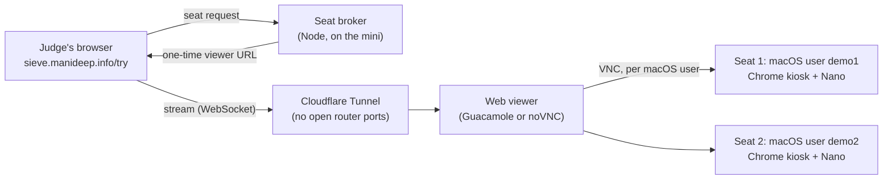
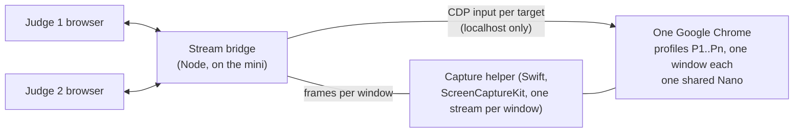

# Sieve implementation spec: 80 Demo computer ("Try it on a real computer")

A real Mac with Gemini Nano ready, streamed into the Sieve website so judges without Nano can still use the on-device path. Read [00-overview.md](00-overview.md) first. This is work package WP10; it builds on the hosted web app (40) and the extension (50), and never replaces the Playground.

## 1. What judges see

On the Playground and the landing page, a button **"Try it on a real computer"** with the line "A Mac with Gemini Nano ready to go, streamed to your browser. About 15 minutes per visit."

1. Click → `/try` asks the broker for a seat.
2. A seat is free → the page embeds the seat's screen (full width, 16:10), with a strip on top: "Real computer · Gemini Nano on this machine · {mm:ss} left · End session".
3. No seat free → "Both demo computers are in use. You're number {n} in line (about {m} min). The Playground works right away in the meantime." plus a Playground link. The page polls the queue every 10 s.
4. Broker or machine unreachable → the button hides; `/try` says "The demo computer is offline right now. The Playground shows everything with cloud answers on sample data."

Inside the stream: Chrome in kiosk mode on the Sieve Playground, Nano ready (trace shows "This device · Nano"), the image flag on (live "Caption live" works), the Sieve extension installed with its shortcut (50 section 8.9). Nothing else on screen.

## 2. Hardware and capacity

The demo machine is Mani's Mac mini: **Apple M4, 16 GB unified memory**, internal SSD with hundreds of GB free after it is erased.

| Seats at once | Memory estimate | Plan |
|---|---|---|
| 1 | macOS about 3 GB + Chrome and Sieve about 1.5 GB + Nano about 4 GB | Smooth |
| 2 | about 14 GB | **Default.** Confirm with the load test (section 9) |
| 3 | about 19 GB | Only if the load test shows Chrome unloads idle models and answers stay under 20 s with three active seats |

Each macOS user has its own Chrome data folder, so each seat downloads its own Nano copy (about 4 GB on disk) and loads its own copy into memory while in use. Disk: keep at least 40 GB free at all times (Chrome deletes the model below 10 GB free and needs 22 GB free to download it).

## 3. Architecture

- **Seats** are separate macOS standard users (`demo1`, `demo2`, optionally `demo3`), each logged in to its own GUI session, each running Chrome in kiosk mode on the Sieve Playground. Separate users are required because a screen stream shows a whole session; two judges in one session would share one mouse.
- **The web viewer** shows one seat's session in the judge's browser. **Decided Nov 17 (section 9 test): noVNC + websockify**, through a per-seat auth proxy on the mini that logs in to macOS Screen Sharing with the seat's credentials, so the seat password never reaches a visitor's browser. The viewer attaches to each user's own virtual display (`vfb 1` in the screen-sharing daemon's log), not the console, so two seats run independently. Guacamole was not needed.
- **The seat broker** is a small Node service on the mini: seats, leases, the queue, resets and health. It issues one-time viewer URLs (random token, valid for one lease) so a viewer link cannot be shared or reused.
- **Cloudflare Tunnel** (`cloudflared`, tunnel `sieve-demo`) publishes only two hostnames: `sieve-seats.manideep.info` (broker API) and `sieve-view.manideep.info` (viewer). Single-label names under the site's own domain, because two-label names such as `view.sieve.manideep.info` get no certificate on Cloudflare's free plan. No router ports are opened; the mini's real IP is never exposed.

## 4. Seat broker

| Endpoint | Does |
|---|---|
| `POST /seat` | Returns `{ status: 'granted', viewerUrl, endsAt }`, or `{ status: 'queued', position, etaMinutes, ticket }`. One active lease per browser (a cookie-bound ticket). |
| `GET /queue/{ticket}` | Position and ETA, or `granted` with a `viewerUrl` once a seat frees up. |
| `POST /seat/{lease}/end` | Ends the lease early ("End session"). |
| `GET /health` | `{ ok, seatsFree, seatsTotal }`; the Sieve page hides the button when this fails twice in a row. |

Rules: lease 15 minutes, extendable once by 5 minutes if nobody is queued; 2 minutes with no input ends the lease ("Ended because the session was idle."); at most 30 seat grants per hour overall and 3 per browser per day; a queue of at most 10. State lives in memory with a small JSON snapshot on disk, so a broker restart keeps leases.

**Reset at lease end** (per seat, about 20 s; the seat shows "Getting ready for the next visitor"):
1. Quit Chrome for that user.
2. Restore the user's Chrome profile from a golden copy (`rsync --delete`), **excluding the `OptGuideOnDeviceModel` folder**, so the Nano model is kept and Sieve's IndexedDB, cookies and history are wiped.
3. Relaunch Chrome in kiosk mode (the LaunchAgent in section 5 does this automatically).
4. Wait until the Playground loads, then mark the seat free.

## 5. Machine setup checklist (Mani, once, on the mini)

**As built, Nov 16 to 17** (the vault note "Mac mini setup - Nov 17, 2026" and its SETUP-LOG hold every command): the mini was erased; admin `mani`, seat users `demo1` and `demo2` (standard); **FileVault off**, so it restarts unattended after a power cut (verified: both seats and all services back in about 90 s); SSH key-only; Tailscale as a system daemon; everything under `/opt/sieve-demo`. Differences from the list below: seat users had to be added to the group `com.apple.access_screensharing` (Screen Sharing was limited to administrators); Chrome policy must come through a configuration profile (a plist written to `/Library/Managed Preferences` by hand is deleted at the next login); the lockdown profile applies to every user on the mini; the Nano download policy only marks the model downloadable, so a `LanguageModel.create()` with a user gesture starts the download per seat; `demo1` logs in automatically at boot and `demo2`'s session is created by a Screen Sharing login from a supervisor daemon, which also relaunches kiosk Chrome if it dies. Still open: the allowlist of Firebase and Google hosts in the lockdown profile is a guess until the site exists; `DeveloperToolsAvailability 2` may disable the unpacked extension (check in a seat); silence macOS notifications in seat sessions; remove `/etc/sudoers.d/mani-setup` when setup ends.

1. Move anything still needed off the mini (Obsidian vault and connector, documents), then **erase it and reinstall macOS**. Nothing personal stays on a machine strangers control.
2. One admin account for Mani (FileVault on, strong password, not used for seats). Seat users `demo1`, `demo2` (and `demo3` for the load test) as **standard** users.
3. Network: connect the mini to a **guest network or VLAN** that cannot reach other home devices; macOS firewall on, stealth mode on.
4. Power: `sudo pmset -a sleep 0 displaysleep 0 disksleep 0 autorestart 1` (never sleep; restart after a power cut); log in the seat users at boot (automatic login for one user, the others through the broker's start script).
5. Updates: pause macOS and Chrome updates from Nov 27 to Dec 16 (Chrome policy `UpdatesSuppressed` or the update-check toggle; record the Chrome version that was tested).
6. Screen Sharing on, limited to the seat users and the viewer host.
7. Per seat user: install Google Chrome (not Chromium; Nano is only in Google Chrome); turn on `chrome://flags/#prompt-api-for-gemini-nano-multimodal-input`; open the Playground and run setup until Nano is ready; install the Sieve extension (unpacked, from the release zip) and pin it; then save this profile as the seat's golden copy.
8. Chrome policies for the seat users (a configuration profile): `URLBlocklist: ["*"]` and `URLAllowlist` for `sieve.manideep.info` plus the Firebase and Google endpoints the app needs; `DeveloperToolsAvailability: 2` (blocked); `DownloadRestrictions: 3` (no downloads); `PrintingEnabled: false`; `IncognitoModeAvailability: 1` (disabled); `BrowserSignin: 0`; `PasswordManagerEnabled: false`.
9. A LaunchAgent per seat user runs Chrome in kiosk mode on `https://sieve.manideep.info/playground?seat=1` with `KeepAlive`, so quitting relaunches it.
10. Install the viewer (Guacamole in Docker, or noVNC + websockify), the broker, and `cloudflared` as launch daemons; point the tunnel at the broker and the viewer only.

## 6. Security

The machine is a stranger-controlled computer on Mani's home internet for a week, so every layer assumes a hostile visitor:

- **No personal data on the machine** (erased first) and **no secrets in seat accounts** (no Pawl keys, no tokens, no Apple ID signed in for seat users).
- **Network isolation:** guest network or VLAN; Chrome limited to the allowlist; no other apps reachable (kiosk + standard users + no Terminal in the Dock; the stream shows only the kiosk window).
- **No open ports:** only the Cloudflare Tunnel, which publishes the broker and viewer hostnames.
- **One-time viewer URLs** per lease; the broker rate-limits and caps the queue.
- **Wipe between visitors** (section 4), so nothing one judge types is seen by the next.
- **Watch it:** the broker logs grants and resets (no screen content); Mani gets a push (or email) when a seat fails its reset or the health check fails three times.

## 7. Web app changes (40)

- New route `/try` (section 1), the "Try it on a real computer" button on the Playground strip and the landing page, shown only while `GET /health` succeeds.
- Embed the viewer in an iframe (`allow="clipboard-read; clipboard-write; fullscreen"`), with the timer strip and "End session". Hosting headers: allow framing the viewer hostname in the CSP (`frame-src https://sieve-view.manideep.info`); the broker API is `https://sieve-seats.manideep.info` (`connect-src`).
- README and Devpost text: "No Gemini Nano on your machine? Click **Try it on a real computer** to use Sieve on a Mac with Nano ready (one of two seats, about 15 minutes)."

## 8. Schedule

| When | What |
|---|---|
| Nov 17 to 18 (day-1 checks) | The section 9 test on the mini, before erasing it if possible (a spare admin user is enough) |
| After the core app works | Set up the machine (section 5), broker, viewer, tunnel |
| Nov 28 | Rehearse a full judge visit from another network; record the result |
| Nov 29 to Dec 16 | Keep it running; daily check of `/health` and one real visit |

## 9. The test that decides the design (do this first, about 45 minutes)

1. Create two extra standard users; log both in (Fast User Switching), so three sessions exist.
2. From another computer, open the browser viewer (noVNC or Guacamole) to each user. **Pass:** each viewer shows its own user's desktop, independently. **Fail:** only the console session shows; then plan one seat plus the queue.
3. In each session, open Chrome with Nano ready and ask the same Playground question at the same moment in two sessions, then three. Record answer times and macOS memory pressure (Activity Monitor). **Pass for 2 seats:** answers under 20 s, memory pressure yellow at worst. Try 3 seats the same way; use 3 only if it passes too.
4. Leave three sessions idle for 5 minutes, then check memory: does Chrome unload Nano when idle? (This decides whether 3 seats are realistic on 16 GB.)
5. Write the results into this section (date, Chrome version, numbers) and set `SEATS` in the broker config.

**Results (Nov 17, 2026; macOS 26.6.2, Chrome 157, three GUI sessions, noVNC reached over an SSH tunnel):**

| Check | Result |
|---|---|
| Viewer reaches a user's own session (step 2) | Pass: the viewer attached to the test user's virtual display while the monitor showed another session |
| One seat alone, about 120-word answer | first token 180 ms, full answer 5.2 to 5.6 s, about 160 chars/s |
| Two seats at once | first token 194 ms and 837 ms, full answers 8.4 s and 8.8 s, about 93 chars/s each |
| Memory, two models answering at once | free memory 79% to 31%, swap 201 MB; the two models take about 7.7 GB together |
| Idle (step 4) | the model is unloaded when the page's session is destroyed; free memory back to 69% a minute later |
| Three seats | not realistic: a third model would need about 11.5 GB for models alone and run on swap |

**Decision: design A with `SEATS = 2`.** Design B is not needed.

## 10. Acceptance tests

1. With both seats busy, a third visitor is queued with a position, and gets a seat within 30 s of one ending.
2. A viewer URL works for exactly one lease; reusing it after the lease ends shows "This session has ended."
3. After a lease ends, the next visitor's seat shows a fresh Playground (no previous questions, receipts or uploads), and Nano answers without a new download.
4. In a seat: typing another address, opening DevTools, downloading a file or quitting Chrome does not escape the kiosk (Chrome relaunches on quit).
5. From the seat, the home network's other devices are unreachable (ping and port scan fail).
6. Pulling the mini's network cable hides the button on the site within 1 minute; restoring it brings the button back.
7. A power cut and restore brings the seats back without Mani touching the machine.

Status Nov 17: tests 1, 2, 3, 4 and 7 passed on the mini (test 4: Command+Q, Command+Tab, Command+Space and Control+Command+Q cannot leave the kiosk for long). Tests 5 and 6 wait for the Sieve site.

## 11. Verify at implementation

| # | Check | How |
|---|---|---|
| V1 | A browser viewer can reach non-console macOS sessions | Section 9 step 2 |
| V2 | Memory and speed with 2 and 3 active seats on the M4 16 GB | Section 9 step 3 |
| V3 | Chrome unloads Nano from memory when a session is idle | Section 9 step 4 |
| V4 | Chrome policies apply to standard users through a configuration profile on current macOS | Install the profile, check `chrome://policy` in a seat |
| V5 | Kiosk mode plus `KeepAlive` cannot be escaped by keyboard shortcuts | Try Command+Q, Command+Tab, Command+Space, Mission Control in a seat |
| V6 | Cloudflare Tunnel latency for the stream from a few networks | Rehearsal on Nov 28 |

## 12. Upgrade path: design B (one Chrome, a window per judge)

Use B only if design A's test fails (no browser viewer can reach extra macOS sessions) or its 2 seats prove too few. A gives every judge a fully clickable Chrome in their own macOS session; B gives more judges at once on 16 GB, at the cost of more engineering.

### 12.1 Why B is different
macOS sends keyboard input to one frontmost window per session, so several judges cannot type into several windows of one session through screen sharing. B avoids OS input entirely: each judge's window is **captured** separately (toolbar and side panel visible), and each judge's clicks and keys are **sent straight into their own page and side panel** through Chrome's DevTools Protocol (CDP), which does not need OS focus.

### 12.2 Pieces
1. **One Google Chrome, one profile per seat.** Each seat is a separate Chrome profile (its own storage, so judges never share the Playground's IndexedDB), each with one window. The Nano model sits at the top of Chrome's data folder and runs in one model service, so all profiles share **one Nano in memory** (verify, 12.4 step 4). The Sieve extension is installed in every profile; at setup Mani opens the side panel once in each window, and it stays open across resets.
2. **Chrome flags** so windows that are behind others keep working: `--disable-backgrounding-occluded-windows --disable-renderer-backgrounding --disable-background-timer-throttling`, plus `--remote-debugging-port=9222` bound to localhost (the bridge is its only client; the port is never published by the tunnel).
3. **Capture helper:** a small Swift command-line tool using ScreenCaptureKit to capture each seat's window (by window id) at 15 to 20 frames per second, scaled to 1280 px wide, sent to the bridge as encoded frames.
4. **Stream bridge (Node):** one WebSocket per judge carrying that window's frames out, and the judge's mouse and key events in. It owns the seat leases (reusing section 4's broker rules and endpoints).
5. **Input routing:** the bridge knows each window's layout (queried over CDP from the page: `window.screenX/Y`, `outerWidth/innerWidth`, `outerHeight/innerHeight`, plus the side panel's own target and its width). A click inside the page viewport becomes `Input.dispatchMouseEvent` on the page target; a click inside the side panel becomes the same on the side panel's extension target; clicks on the toolbar are ignored (judges stay on Sieve). Keys go to whichever of the two targets the judge last clicked, with `Input.dispatchKeyEvent` and `Input.insertText` (for typed text and emoji).
6. **Reset between judges:** through CDP `Runtime.evaluate` on that seat's page, call the app's own Playground reset (clears its IndexedDB, local storage and receipts), then reload. The model and the open side panel stay.

### 12.3 Limits
- The toolbar is visible but not clickable; the extension's side panel is interactive only because it is already open.
- Simultaneous questions share the M4's GPU, so overlapping answers are slower.
- More moving parts than A (a native helper and a custom bridge): about 2 to 3 days.

### 12.4 The B test (about 1 hour, before building it)
1. Start Chrome with the flags and three profiles, one window each, partly overlapping. Ask a Playground question in a window that is **not** in front. **Pass:** Nano answers normally (trace shows "This device · Nano").
2. Over CDP, click and type into a background window's page and into its side panel. **Pass:** both receive input while another window stays in front.
3. Capture three windows with ScreenCaptureKit at 15 fps. **Pass:** each stream shows its own window, including the toolbar and the side panel, and CPU stays under 40%.
4. Activity Monitor during three simultaneous questions. **Pass:** one Nano model in memory (not three); memory pressure no worse than yellow; answers under 20 s.
5. Record results here and choose: A only, B, or A now and B later.
